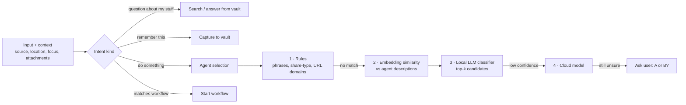

# Agents, Runtimes and Routing

> Status: draft v0.1

## 1. What an agent is

An **agent** is a vault note in `agents/` — YAML frontmatter for configuration, Markdown body for its
instructions and playbook. Creating an agent is writing a note (from Obsidian, the web Agent Studio,
the iOS app, or by another agent with approval).

```markdown
---
type: agent
id: grocery-continente
name: Grocery (Continente)
description: Buys groceries on continente.pt from a list and guidelines. Use for shopping lists,
  supermarket orders, "buy the usual".
icon: cart
runtime: auto                # auto | claude-code | codex | openai | ollama | anthrex | shell | browser | workflow
runtimes: [claude-code, codex, browser]   # optional ordered list (implies auto)
model: smart                 # model alias resolved by policies/models.md
tier: medium                 # simple | medium | heavy  (used for routing, runtime choice + escalation)
node:
  tags: [browser]            # node selector
tools:
  - browser
  - memory.search
  - vault.write
  - ask_user
  - request_approval
limits:
  max_runtime: 30m
  max_cost_eur: 0.50         # LLM spend per run
  max_spend_eur: 150         # real-world money per run
policy:
  spend: biometric
  substitutions: approve
memory:
  reads: ["[[Shopping preferences]]", "products/"]
  writes: "episodes/shopping/"
triggers:
  - phrase: ["groceries", "compras", "lista de compras", "buy the usual"]
version: 3
---

# Grocery (Continente)

## Goal
Fill a Continente cart that matches the list and the guidelines, then ask for approval to check out.

## Playbook
1. Resolve each list item against [[Shopping preferences]] and `products/` notes.
2. ...

## Lessons learned
<!-- appended by the agent after each run -->
```

### Fields

| Field | Meaning |
|---|---|
| `runtime` | Which adapter executes it (see §2), or `auto`: the hub picks one (§2.1). |
| `runtimes` | Optional ordered runtime list (e.g. `[claude-code, codex]`); implies `auto`. |
| `claude` / `codex` | Per-agent CLI settings for the Claude Code / Codex runtimes (§2.2). |
| `model` | Alias, not a provider model id. Aliases live in `policies/models.md` and map to local (Ollama) or cloud models. |
| `tier` | Cost/difficulty class. Drives routing and escalation. |
| `node` | Selector: tags, explicit node id, or `any`. |
| `tools` | Allow-list. Runtimes that bring their own tools (Claude Code, Codex) also get these via MCP (§2.3). `browser` (or `browser.*`, `browser.<tool>`) adds the browser tools to any runtime. |
| `limits` | Per run: time, LLM cost, real spend, max sub-tasks. Whole tree (when the agent's task is a root): `max_depth`, `max_parallel`, `max_tasks`, `max_runs`, `max_tree_cost_eur` (enforced by the hub). |
| `policy` | Per-agent overrides of trust levels (cannot be looser than global policy unless global allows). |
| `memory` | `reads` are injected into every run's context (`[[Note]]`, `folder/`, `search: q`); `writes` is where it writes episodes. |
| `triggers` | Phrases/patterns used by the rule stage of the router; schedules and events live in workflows. |
| `skills` | Reusable skill notes (`skills/<id>.md`): instructions appended, tools merged at assignment ([SWARMS.md](SWARMS.md) §2.1). |
| `inputs` / `output` | JSON Schemas of structured params and result; the hub validates the result (one automatic repair run) and stores it in `Task.result`. |
| `review` | `{critic, rounds, criteria}`: reflection loop — a critic agent approves or sends feedback for a revision. |
| body | System instructions + playbook. "Lessons learned" is appended by the agent (procedural memory). |

Agent notes are versioned by git; the Agent Studio shows diffs and lets you roll back.

---

## 2. Runtimes

All runtimes implement one Go interface on the Node:

```go
// internal/runtime/runtime.go (sketch)
type Runtime interface {
    Name() string
    Capabilities() Capabilities // streaming, steering, native tools, approvals hook, cost reporting
    Start(ctx context.Context, spec RunSpec) (Run, error)
}

type Run interface {
    Events() <-chan Event                                   // text, tool_call, tool_result, ask, approval_request, cost, artifact, done
    Send(ctx context.Context, in Input) error                 // user message / answer to a question
    Resolve(ctx context.Context, approvalID string, d Decision) error
    Cancel(ctx context.Context) error
}
```

| Runtime | Best for | How Nexus drives it |
|---|---|---|
| `claude-code` | Medium/heavy work on the Claude subscription: coding, research, shopping (with browser tools), assistants | Headless `claude -p` with streaming JSON in/out; Nexus MCP server attached; permission prompts routed to Nexus approvals via a permission-prompt tool. |
| `codex` | Second runtime on the ChatGPT subscription; coding, parallel attempts | `codex exec` non-interactive with JSON events; sandbox from agent settings; Nexus MCP attached. |
| `openai` | General agents on any OpenAI/Anthropic-compatible model (local Ollama or cloud) | Native Go agent loop (tool calling) over OpenAI-compatible API. |
| `ollama` | Cheap/private simple work: routing, tagging, summarizing, extraction | Same native loop, local endpoint. |
| `anthrex` | Whatever Anthrex specializes in | Adapter over Anthrex's interface (TBD — see OPEN_QUESTIONS). Anthrex repo is not modified. |
| `shell` | Scripts, ops, deterministic jobs | Command templates with typed params; stdout/stderr streamed. |
| `browser` | Sites without APIs (Continente, portals) | Playwright with persistent profiles per site on the Node; driven by an LLM loop with a page-snapshot tool; screenshots as artifacts. |
| `workflow` | Composite agents | The agent is a workflow (see WORKFLOWS.md). |

### 2.1 `runtime: auto`, subscriptions and usage limits

The owner's main "smart" capacity is usually **subscriptions** (Claude Pro/Max, ChatGPT
Plus/Pro), which can only be used through the official CLIs: Claude Code (`claude`) and the
OpenAI Codex CLI (`codex`). Nexus drives those CLIs on a node exactly as they are logged in; it
never extracts their tokens. Local Ollama (native loop, runtime `ollama`) does the cheap work.
API-key providers stay supported (runtime `openai`) but are optional.

- `runtime: auto` uses the tier's list from `policies/models.md`:
  ```yaml
  runtimes:
    simple: [ollama, codex, claude-code]
    medium: [claude-code, codex, ollama]
    heavy:  [claude-code, codex]
  ```
  (built-in defaults when the note is missing or unreadable). `runtimes: [codex, claude-code]` in
  an agent note sets the agent's own order (with or without `runtime:`).
- **Selection.** For each run the hub tries the list in order and dispatches to the first runtime
  that a connected node matching the agent's node tags reports as available (`NodeHello`
  runtimes). The chosen runtime goes into the assignment's agent copy and is stored on the run.
  An unspecified tier counts as `medium`.
- **Availability.** `claude-code`: the `claude` binary answers `--version` (there is no reliable
  non-interactive login check; a missing login shows up on the first run). `codex`: the binary
  answers and `codex login status` does not say "not logged in". Availability is probed when the
  node connects: restart `nexus-node` after logging in.
- **Usage limits → next runtime.** When Claude Code or Codex stops on a usage/rate limit, the run
  fails with a clear summary ("Claude usage limit reached; resets 3pm.") and
  `result.error_kind = "rate_limited"`; a CLI that is not logged in fails with a how-to-log-in
  summary and `error_kind = "auth"`. For both kinds the task engine moves the task to the **next
  runtime of the agent's list** (a new run on the same task, `previous_attempt` and an
  `escalation_hint` in its context, a RunOutput line telling the user). When nothing is left the
  task fails with the original summary.
- **Concurrency.** Each node caps parallel runs per runtime (`runtime.claudecode.max_concurrent`,
  `runtime.codex.max_concurrent`, default 2; `node.max_concurrent: {runtime: n}` overrides). Runs
  beyond the cap wait in a FIFO queue and show "Waiting for a free Claude Code slot…".

### 2.2 Claude Code and Codex for non-coding agents

Agent notes may carry CLI settings (forwarded to the node in the run context):

```yaml
claude:
  model: sonnet                # sonnet | opus | haiku | full model id (default: smart→sonnet, best→opus)
  allowed_tools: [WebSearch, WebFetch]   # Claude Code built-ins to allow (pre-approved)
  disallowed_tools: [Task]
  permission_mode: default     # default | acceptEdits | plan (bypassPermissions is ignored here)
  max_turns: 30
  coding: false                # true keeps Claude Code's Bash/Edit/Write
codex:
  model: gpt-5-codex           # or an alias mapped by runtime.codex.models ("" = CLI default)
  sandbox: read-only           # read-only | workspace-write
  coding: false
```

A **non-coding** agent (no `coding: true`, no configured workdir / `repo_dir`) runs Claude Code
with `--disallowedTools Bash,Edit,MultiEdit,Write,NotebookEdit,WebSearch,WebFetch` (minus
`claude.allowed_tools`) and `--allowedTools mcp__nexus[,…]`, so it acts through Nexus tools, and
Codex with `--sandbox read-only`. Instructions go in via `--append-system-prompt` (Codex: prepended
to the prompt); the run's final answer becomes the task summary (and a workflow step's result).

### 2.3 Nexus tools over MCP (Claude Code, Codex)

Each CLI run gets a loopback Nexus MCP endpoint serving the run's allow-listed tools
(`memory.search` → `mcp__nexus__memory_search`, `web.search`, `vault.*`, `ask_user`,
`request_approval`, `spawn_agent`, node tools…) plus **run tools from providers**: node modules
register a `kernel.RunToolProvider`; the node's run manager asks every provider for each run and
adds the tools the agent's allow-list permits. The browser module provides `browser.*` with the
same domain allow-list, per-store profiles and shops.get handling as the browser runtime. Every
Nexus tool call is gated by the run's approval gate (agent policy); the browser's checkout /
payment click additionally asks for a **SPEND** approval (biometric by default) through
`RunSpec.Gate`, which the runtime binds to that same gate — so a Claude Code shopping agent still
needs Face ID to pay. Without the MCP bridge (disabled) such clicks are refused.

### The native agent loop (`openai` / `ollama`)

Nexus ships its own small, fast agent loop in Go: messages + tool schema → model → tool calls →
policy check → execute (locally on the Node or proxied to the Hub) → repeat until done or limits hit.
Every step emits events, so the phone sees exactly what is happening.

### Nexus tools available to every agent

| Tool | What it does |
|---|---|
| `memory.search` | Hybrid search (FTS + vectors + graph neighbours) over the vault. |
| `vault.read` / `vault.write` / `vault.link` | Read and write notes; writes are policy-checked and committed. |
| `ask_user` | Ask a question with optional choices → push notification → answer flows back. |
| `request_approval` | Explicit approval for an action with a preview payload. |
| `notify` | Send a result/notice to the Inbox (no response needed). |
| `spawn_agent` | Create a sub-task for another agent (by id or by description → router). |
| `node.exec` / `node.files` | Run commands / move files on a (permitted) node. |
| `schedule` | Create a reminder/follow-up task in the future. |
| integration tools | email, calendar, GitHub, Home Assistant… (when connected and allowed). |

---

## 3. Model aliases and tiers

`policies/models.md` maps aliases to concrete endpoints so agents never hard-code providers:

```yaml
aliases:
  fast-local:  { provider: ollama,  model: "<small local model>", node: gpu-box }
  smart:       { provider: ollama,  model: "<model name>" }
  best:        { provider: ollama,  model: "<model name>" }
  embed:       { provider: ollama,  model: "<embedding model>" }
tiers:
  simple: [fast-local, smart]
  medium: [smart, best]
  heavy:  [best]
runtimes:                       # runtime: auto (§2.1)
  simple: [ollama, codex, claude-code]
  medium: [claude-code, codex, ollama]
  heavy:  [claude-code, codex]
```

---

## 4. Router

The router answers: *what is this input, and who should handle it?*



Output:

```json
{ "kind": "task", "agent": "grocery-continente", "tier": "medium",
  "confidence": 0.91, "params": { "list": [...], "deadline": "saturday" },
  "reason": "shopping list shared from Notes" }
```

- **Every decision is logged** (input, candidates, choice, confidence, latency, cost).
- **Corrections are training data:** when you change the agent from the phone ("no, use X"), the
  pair is stored. The dashboard's Router page shows accuracy and lets you export a dataset.
- **Fine-tuned router (later):** a small local model fine-tuned on these logs becomes stage 3;
  the cloud stage becomes the fallback.

### Escalation

A run escalates to the next tier when: the model reports low confidence, a verifier check fails
(schema validation, tests, a judge prompt), the run exceeds its step budget without progress, or the
user taps **"Try harder"**. Escalation is a new run on the same task; history is passed along.

### Parallel attempts

For important tasks an agent can be configured with `strategy: race` (first good result wins) or
`strategy: compare` (e.g. Claude Code and Codex both attempt; you pick on the phone).

---

## 5. Multi-agent orchestration — teams

See **[SWARMS.md](SWARMS.md)**. A **team** (`teams/<id>.md`) is an orchestrator plus members
(`{agent, role, count, when}`) with a strategy (`hierarchical | parallel | pipeline | debate | auto`),
a shared blackboard, limits and approval bundling. `CreateTask{team_id}` (or the router, which treats
teams like agents) starts a team run: the orchestrator — any runtime — gets team tools
(`team.delegate`, `team.delegate_many`, `team.await`, `team.spawn`, `team.blackboard.*`,
`team.message`, `team.status`, `team.cancel`, `team.run_strategy`), members get `team.report`,
`team.message` and the blackboard.

- Tasks form a **tree**; `Task.tree_cost` rolls costs up live; `TeamService.GetTeamRun` returns the tree.
- **Guardrails in the hub:** max depth, tasks, parallel slots (others queue), runs, tree budget and
  timeout; cancel cascades; spawned specialists never exceed the orchestrator's tools or policy;
  `anthrex.*` tools only for coding agents.
- **Bundled approvals:** approvals carry `root_task_id` / `team_id` / `role` / `bundle` for grouping.
- Plain `spawn_agent` sub-tasks use the same tree rules (limits from the root agent).

---

## 6. Learning agents (procedural memory)

After a run, the agent (or a cheap reviewer model) appends to **Lessons learned** in its note:
selectors that changed, user corrections, faster paths. Changes are committed with the run id, so
any lesson can be traced and reverted. Repeated identical corrections trigger a suggestion to change
the agent's instructions or policy.

---

## 7. Trust and autonomy

Every tool call is classified into an **action class** and checked against policy:

| Action class | Examples | Default level |
|---|---|---|
| `read` | search, read files, browse | auto |
| `write_internal` | write vault notes, create tasks | auto / notify |
| `compute` | run code in a workspace | auto (sandboxed) |
| `write_external` | send email/messages, post, create PR | approve |
| `code_push` | push to a remote branch | approve |
| `spend` | purchases, paid APIs over budget | biometric |
| `destructive` | delete files, drop data, force-push | biometric |
| `device_control` | smart home, wake/sleep machines | notify / approve |

Levels: **auto** (just do it) → **notify** (do it, tell me) → **approve** (wait for a tap) →
**biometric** (Face ID + signed approval).

**Earned autonomy:** after N approvals of the same agent+action pattern with no denials/corrections,
Nexus suggests lowering the level for that pattern. You always confirm the change.
