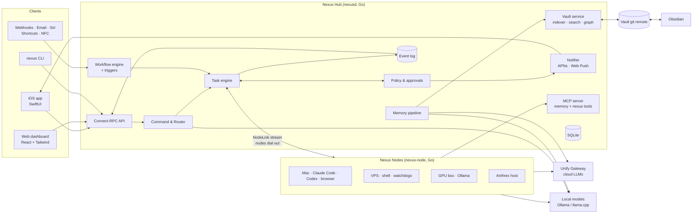
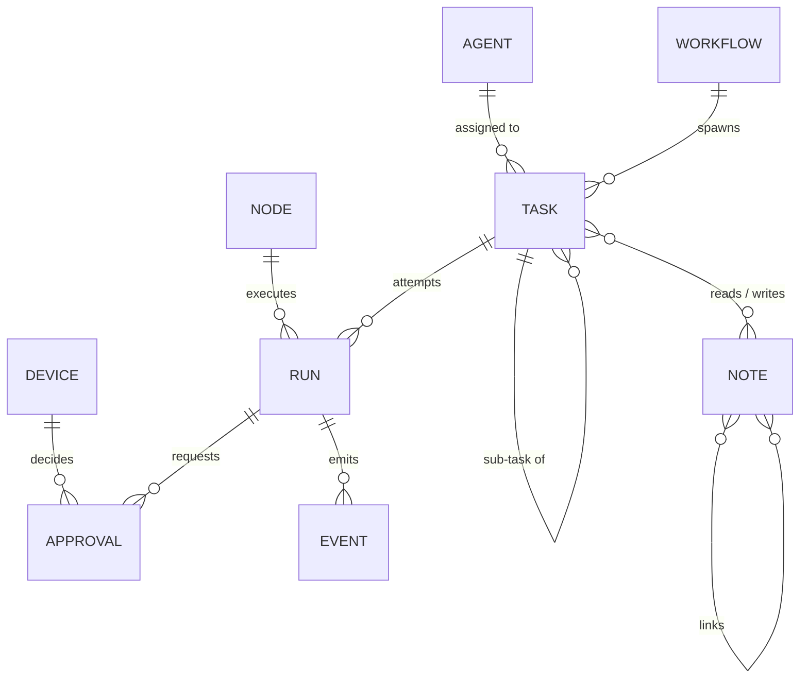
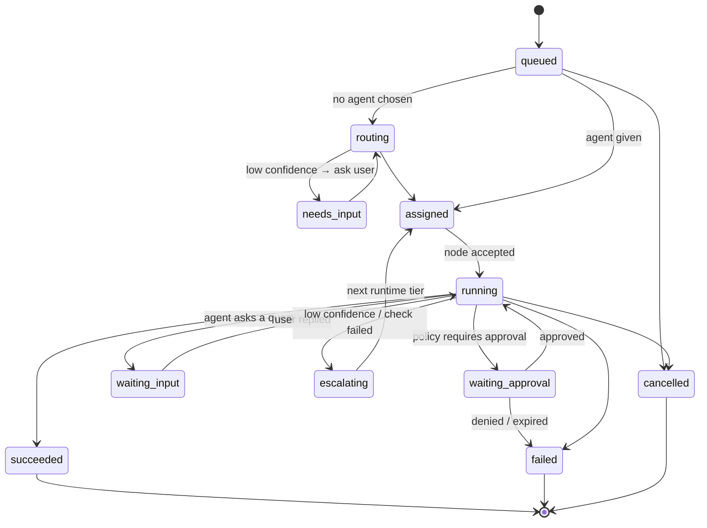
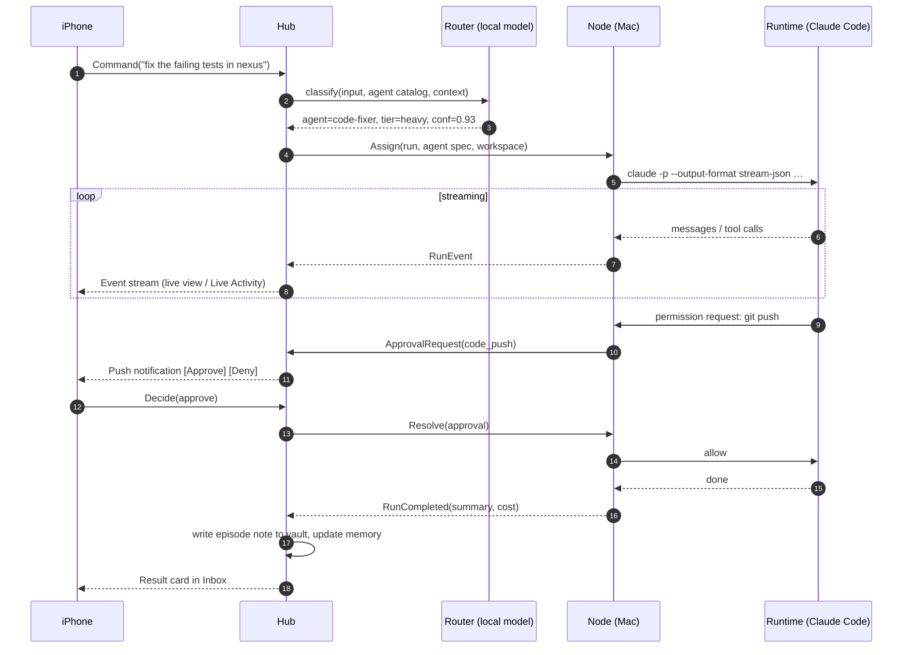

# Nexus — Architecture

> Status: **draft v0.1** — living document. Decisions are recorded as ADRs in [`decisions/`](decisions/).

Nexus is a personal **agent operating system**: one hub that knows your machines, your agents and your
knowledge, and lets you drive all of it from an iPhone app and a web dashboard.

- **Agents** do the work. An agent is a configuration (a Markdown note) bound to a **runtime**:
  Claude Code, Codex, a local model, any model via Unify Gateway, Anthrex, shell, browser…
- **Nodes** are your machines. A small Go daemon on each one executes agents and tools.
- **The Hub** routes, schedules, approves, remembers and notifies.
- **The Vault** is the memory: an Obsidian-compatible folder of Markdown notes, indexed into a graph.
- **Clients** (iOS, web, CLI) are thin views over one shared API and one event stream.

---

## 1. System overview



### Design principles

1. **One brain, many hands.** The Hub owns state, policy and memory. Nodes are stateless executors
   that can be added or wiped at any time.
2. **Files are the source of truth for knowledge.** The vault is plain Markdown in git; every index
   is disposable and rebuildable. You can always open it in Obsidian.
3. **Configuration is knowledge.** Agents, workflows and policies are vault notes too — editable
   from Obsidian, the web dashboard, the phone, or by an agent.
4. **Everything is an event.** Every state change is appended to an ordered event log. Clients sync
   by cursor, so offline phones catch up and the UI can replay any run.
5. **Nodes dial out.** No inbound ports on your machines. The Hub is the only thing exposed.
6. **Cheap first, escalate when needed.** Local models handle simple work; cloud models and coding
   agents are used when the task needs them.
7. **Human in the loop by policy, not by habit.** Each action class has a trust level; agents earn
   autonomy over time.
8. **Single binaries.** `nexusd` and `nexus-node` are self-contained Go binaries with embedded
   storage. No Kubernetes, no external database needed to start.

---

## 2. Components

### 2.1 Hub — `nexusd`

| Module | Responsibility |
|---|---|
| **API** | Connect-RPC services (gRPC, gRPC-Web and JSON over HTTP from one handler). Auth middleware. |
| **Command & Router** | Takes any free-form input (command bar, Siri, share sheet) and decides: search, capture, task, or workflow — and which agent/runtime tier. See [AGENTS.md §4](AGENTS.md#4-router). |
| **Task engine** | Task state machine, assignment to Nodes, retries, escalation, sub-task trees, cancellation. |
| **Workflow engine** | Executes workflow notes (steps, conditions, loops, parallel branches, approvals). |
| **Triggers** | Cron schedules, webhooks, email, file/vault changes, location & NFC events from iOS, Node alerts. |
| **Policy & approvals** | Evaluates every sensitive action against trust levels, budgets and per-agent rules; creates approval requests; verifies biometric signatures. |
| **Event log** | Append-only, monotonically sequenced log (SQLite). Fan-out to subscribers. Source for replay, audit and sync. |
| **Vault service** | Owns the canonical vault git repo: read/write notes, auto-commit, push/pull, watch for external edits. |
| **Indexer** | Parses notes → nodes/edges graph, FTS5 full-text, embeddings (sqlite-vec). Rebuildable. |
| **Memory pipeline** | Async workers: summarize episodes, extract entities/facts/preferences, link notes, propose fact updates. |
| **Notifier** | APNs (token auth) for iOS, Web Push for the dashboard; notification categories with inline actions. |
| **MCP server** | Exposes vault/memory and Nexus abilities (`ask_user`, `request_approval`, `spawn_agent`…) to any MCP-capable runtime. |
| **Integrations** | Connectors: email (IMAP/Gmail), calendar, GitHub, Home Assistant, Telegram, webhooks. |

### 2.2 Node — `nexus-node`

| Module | Responsibility |
|---|---|
| **NodeLink** | One long-lived bidirectional stream to the Hub (HTTP/2, mTLS). Heartbeats, assignments, events, reconnect with resume. |
| **Runtime adapters** | Start/stream/steer/stop agents: `claude-code`, `codex`, `openai` (Unify Gateway / any OpenAI-compatible), `ollama`, `anthrex`, `shell`, `browser`. |
| **Tool host** | Native tools: shell, filesystem, browser (Playwright), clipboard, screenshots, HTTP; plus external MCP servers configured on that machine. |
| **Workspaces** | Each run gets a working directory (optionally a git worktree / container) with resource limits. |
| **Local secrets** | API keys, cookies, browser profiles stay on the Node. The Hub only stores references. |
| **Telemetry** | CPU, memory, disk, battery, online state, installed runtimes and versions. |
| **Vault sync (optional)** | Keep a local clone of the vault (e.g. for Obsidian on the Mac). |

### 2.3 Clients

| Client | Stack | Role |
|---|---|---|
| **iOS** | SwiftUI, Swift Concurrency, `connect-swift`, SwiftData offline cache, App Intents, WidgetKit, ActivityKit | Primary remote control. See [CLIENTS.md](CLIENTS.md). |
| **Web** | Vite, React, TypeScript, Tailwind, `@connectrpc/connect-web`, TanStack Query/Router | Dashboard, Agent Studio, Workflow Builder, vault editor and graph. |
| **CLI** | Go, same generated client | Scripting, ops, debugging; `nexus run "..."`. |

### 2.4 LLM access

- **Unify Gateway** is the single door to cloud models (keys, model aliases, cost tracking).
  Assumed OpenAI-compatible until confirmed (see [OPEN_QUESTIONS.md](OPEN_QUESTIONS.md)).
- **Local models** (Ollama / llama.cpp, OpenAI-compatible endpoint) on any Node for routing,
  classification, tagging, summaries and extraction.
- **Claude Code** and **Codex** are *runtimes*, not model endpoints — they run as processes on Nodes
  and bring their own agent loops.

---

## 3. Core domain model



| Entity | Lives in | Notes |
|---|---|---|
| **Agent** | vault `agents/*.md` | Runtime, model tier, tools, node selector, limits, policy overrides, playbook. |
| **Workflow** | vault `workflows/*.md` | Triggers + steps. |
| **Policy** | vault `policies/*.md` | Trust levels, budgets, global rules. |
| **Note / Entity** | vault | People, projects, places, products, episodes… |
| **Task** | Hub DB | A unit of intent ("buy these groceries"). Has a tree of sub-tasks. |
| **Run** | Hub DB | One attempt of a task on a node + runtime. Retries/escalations create new runs. |
| **Event** | Hub DB (event log) | Every message, tool call, output chunk, state change, cost record. |
| **Approval** | Hub DB | Pending decision with action class, risk, payload preview, expiry. |
| **Device** | Hub DB | Paired phone/browser/CLI with its public key and permissions. |
| **Node** | Hub DB | Registered machine with tags, capabilities, status. |

### Task lifecycle



---

## 4. Key flows

### 4.1 Command from the phone



### 4.2 Grocery run (browser agent + memory + approvals)

1. Share a list (text / photo / voice) to Nexus → Command.
2. Router → `grocery-continente` agent (rule match: shopping list).
3. Hub expands the list from memory: `[[Milk]]` → *Mimosa lactose-free 1L ×6* (preference note).
4. Node with tag `browser` runs the agent; browser profile with the logged-in session stays on that Node.
5. Out-of-stock or substitution above threshold → `ask_user` → push with options.
6. Cart ready → approval class `spend` with total, item list and screenshot → **Face ID** approval.
7. Checkout with the payment method already saved in the account (agents never handle card data).
8. Order saved as an episode note, linked to products; preferences updated.

### 4.3 Capture to vault

Share sheet / voice / scan → `Capture` → raw episode note in `inbox/` immediately (works offline,
synced later) → memory pipeline (local model) summarizes, tags, extracts entities, proposes links →
note moved/linked; low-confidence facts go to the **Facts inbox** for confirmation.

### 4.4 Event sync

Clients call `EventService.Subscribe(since_seq)`. The Hub replays events after `since_seq`, then
streams live. Clients persist the last seq. This one mechanism gives: live UIs, offline catch-up,
multi-device consistency, run replay and audit.

---

## 5. Protocols

- **Schema:** Protobuf in [`proto/nexus/v1`](../proto/nexus/v1), managed with `buf`.
  Code generated for Go (`connect-go`), TypeScript (`connect-es`) and Swift (`connect-swift`).
- **Client ↔ Hub:** Connect protocol over HTTPS (HTTP/2 where available). Server streaming for events.
  Works from browsers without a proxy.
- **Node ↔ Hub:** `NodeLinkService.Connect` bidirectional stream over HTTP/2 with mTLS. The Node
  dials out; resume tokens make reconnects lossless.
- **Agents ↔ Nexus tools:** MCP. Every Node runs a local MCP endpoint that proxies to the Hub, so
  Claude Code, Codex and any MCP-aware runtime get `memory.search`, `vault.write`, `ask_user`,
  `request_approval`, `spawn_agent`, `notify` for free.
- **LLMs:** OpenAI-compatible chat completions (Unify Gateway, Ollama).
- **Push:** APNs HTTP/2 with token (`.p8`) auth; Web Push (VAPID) for the dashboard.

---

## 6. Storage

| Data | Store | Why |
|---|---|---|
| Operational state (tasks, runs, events, approvals, devices, nodes, costs) | SQLite (WAL) on the Hub | Embedded, fast, one file, trivial backups. Behind a `store` interface so Postgres is possible later. |
| Knowledge, agents, workflows, policies | Vault: Markdown files in git | Human-readable, Obsidian-compatible, versioned, syncable. |
| Vault index (graph, FTS, vectors) | Separate SQLite (`index.db`) with FTS5 + sqlite-vec | Disposable; rebuilt from files. |
| Large blobs (screenshots, PDFs, audio) | `vault/_attachments/` (git LFS optional) or content-addressed blob dir | Linked from notes. |
| Secrets | Node-local keychain / encrypted file; Hub stores references only | Secrets never transit to clients. |

SQLite driver: pure-Go / no-cgo preferred so binaries cross-compile cleanly — see
[ADR-0005](decisions/0005-sqlite-embedded-storage.md).

---

## 7. Security model (summary)

Full details in [SECURITY.md](SECURITY.md).

- **Pairing:** the Hub shows a QR code (hub URL + one-time token + cert fingerprint). The device
  creates a key pair (iOS: Secure Enclave) and registers its public key.
- **Transport:** TLS everywhere; mTLS for Nodes.
- **Trust levels** per action class: `auto` → `notify` → `approve` → `biometric`.
  Biometric approvals are signed on-device by a Secure Enclave key after Face ID and verified by the Hub.
- **Budgets** per agent / per day / per run; hard stop.
- **Kill switch:** one action stops every run on every Node.
- **Audit:** the event log is the audit log.

---

## 8. Repository layout (target)

```
nexus/
├── proto/nexus/v1/        # API schema (source of truth for all clients)
├── gen/                   # generated code (go, ts, swift) — committed or built in CI
├── cmd/
│   ├── nexusd/            # Hub binary
│   ├── nexus-node/        # Node binary
│   └── nexus/             # CLI
├── internal/
│   ├── hub/               # API handlers, wiring
│   ├── task/              # task engine + state machine
│   ├── router/            # command classification, agent selection, escalation
│   ├── workflow/          # workflow engine, triggers, CEL expressions
│   ├── policy/            # trust levels, budgets, approvals
│   ├── events/            # event log + fan-out
│   ├── vault/             # git vault, parser, indexer, search, graph
│   ├── memory/            # extraction pipeline
│   ├── notify/            # APNs, web push
│   ├── mcp/               # MCP server (hub) + node proxy
│   ├── node/              # NodeLink client, workspaces, telemetry
│   ├── runtime/           # adapters: claudecode, codex, openai, ollama, anthrex, shell, browser
│   ├── llm/               # OpenAI-compatible client (Unify Gateway, Ollama)
│   └── store/             # SQLite repositories, migrations
├── web/                   # Vite + React + Tailwind dashboard
├── ios/                   # SwiftUI app (Xcode project)
├── vault-template/        # starter vault: example agents, workflows, policies
├── deploy/                # systemd units, Dockerfiles, Caddy/Tailscale examples
└── docs/
```

---

## 9. Deployment topologies

| Topology | When |
|---|---|
| **Hub on a small VPS**, Nodes at home/office dial out, phone connects over public HTTPS | Reachable from anywhere, no home ports. Recommended default. |
| **Hub on a home machine** behind Tailscale | Everything private; phone uses Tailscale. |
| **Hub + Node in one process** (`nexusd --with-node`) | Development and single-machine setups. |

---

## 10. Related documents

- [FEATURES.md](FEATURES.md) — full feature catalogue (iOS, web, platform)
- [CLIENTS.md](CLIENTS.md) — iOS app and web dashboard information architecture
- [AGENTS.md](AGENTS.md) — agent definitions, runtimes, router, escalation
- [VAULT.md](VAULT.md) — knowledge vault format, graph, memory pipeline
- [WORKFLOWS.md](WORKFLOWS.md) — workflow format and catalogue of workflows
- [SECURITY.md](SECURITY.md) — pairing, keys, trust levels, threat model
- [ROADMAP.md](ROADMAP.md) — phased delivery plan
- [OPEN_QUESTIONS.md](OPEN_QUESTIONS.md) — decisions still needed
- [decisions/](decisions/) — architecture decision records
