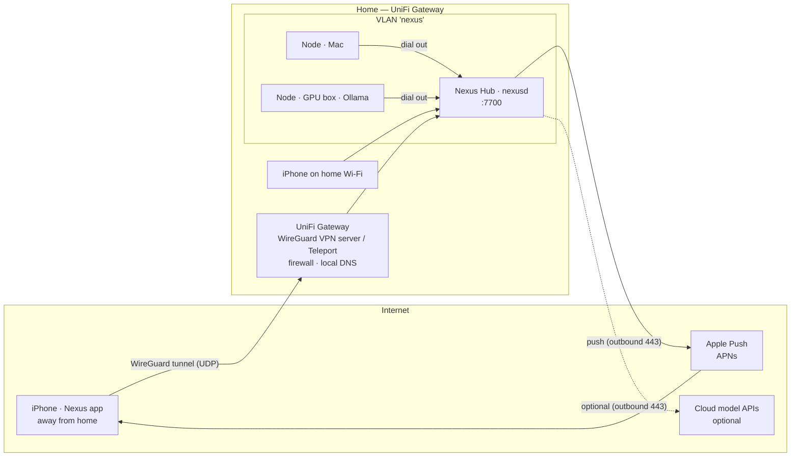

# Network — Reaching Nexus through the UniFi Gateway

> Status: v0.1. The recommended "Fortress" deployment (SECURITY.md §7) for a home with a
> Ubiquiti UniFi Gateway (UDM / UCG / UXG / Cloud Gateway). Nexus is never exposed to the internet:
> the iPhone app reaches the Hub over the UniFi VPN, exactly as if it were on the home Wi-Fi.

## 1. Topology



- **One door:** the UniFi Gateway is the only way in. The app talks to exactly one thing, the Hub
  (`https://nexus.home.arpa:7700`), on Wi-Fi directly and outside the home through the VPN.
- **No port forwarding** to Nexus, ever. The only port open on the WAN is the VPN's (UDP), handled
  by the gateway itself.
- **Outbound only** from the Hub: APNs (push notifications and Live Activities) and, if you use
  them, cloud model APIs. Push therefore works even when the phone's VPN is off; tapping an
  approval brings the VPN up (on-demand) and the app then talks to the Hub.

## 2. Gateway setup (UniFi Network application)

Menu names follow recent UniFi Network versions and may differ slightly on yours.

### 2.1 Network and addressing
1. **Settings → Networks → New Virtual Network**: `nexus` (e.g. `10.20.0.0/24`), on the switch ports /
   Wi-Fi the Hub and machines use. (Using the default LAN also works; a VLAN lets you firewall it.)
2. **Fixed IP** for the Hub machine (Client → Settings → Fixed IP), e.g. `10.20.0.10`.
3. **Local DNS record**: `nexus.home.arpa → 10.20.0.10` (Settings → Routing/DNS → Local DNS records,
   or the DNS settings of your Network version). `home.arpa` is the reserved name for home networks.

### 2.2 VPN for the iPhone — choose one
| Option | How | Notes |
|---|---|---|
| **WireGuard VPN Server** (recommended) | Settings → VPN → VPN Server → Create → WireGuard. Add a client "iPhone", scan the QR with the **WireGuard** iOS app. | In the WireGuard app enable **On-Demand**: connect on cellular and on any Wi-Fi *except* your home SSID. The tunnel can be split (only the `nexus` network + DNS) to save battery. |
| **Teleport** | Settings → VPN → Teleport → enable; connect with the **WiFiman** app. | Easiest setup; fewer controls (no per-network on-demand rules). |
| Tailscale | Subnet router on the Hub machine. | Alternative if you prefer it; not required with UniFi. |

Set the VPN's DNS to the gateway so `nexus.home.arpa` resolves remotely.

### 2.3 Firewall (zone-based firewall or traffic rules)
| From | To | Allow |
|---|---|---|
| VPN clients | Hub `10.20.0.10` TCP 7700 | ✅ |
| Home LAN (your iPhone/Mac on Wi-Fi) | Hub TCP 7700 | ✅ |
| `nexus` VLAN (nodes) | Hub TCP 7700 | ✅ |
| Hub | Internet TCP 443 (APNs `api.push.apple.com`, cloud model APIs) | ✅ |
| Nodes | Internet (browser agents, web research, Claude Code/Codex) | ✅ as needed |
| `nexus` VLAN | rest of the LAN | ❌ (optional hardening) |
| Internet | anything in `nexus` | ❌ (default) |

## 3. Nexus configuration

`nexusd init -hub-url https://nexus.home.arpa:7700 -listen 10.20.0.10:7700` writes this
`nexus.yaml` on the Hub (`-hub-url` is repeatable or comma-separated):

```yaml
server:
  listen: "10.20.0.10:7700"        # bind to the nexus VLAN address, not 0.0.0.0
  tls:
    auto: true                      # TLS 1.3 + HTTP/2, cert from the Hub's private CA
security:
  hub_urls: ["https://nexus.home.arpa:7700"]   # what goes into the pairing QR
  server_names: ["nexus.home.arpa", "localhost", "127.0.0.1", "10.20.0.10"]  # cert SANs (+ listen IP)
```

The CA is created on first start in `<data_dir>/security/pki/ca.crt`; the server certificate is
issued and renewed automatically. Pair with `nexusd pair` (iPhone QR) or `nexusd pair -kind node`,
or from the dashboard (Settings → Pair a device / Pair a machine).

On each machine: `nexus-node pair '<nexus://pair URL>'` writes `hub_url`, `node_id`, `token_file`,
`ca_file` (the only trusted root), `cert_file` and `key_file` into `node.yaml`. CLI on the Hub:
`NEXUS_URL=https://localhost:7700 NEXUS_CA_FILE=data/security/pki/ca.crt nexus status`.

Pair the iPhone **at home on Wi-Fi** (the QR contains the Hub URL and the CA fingerprint the app
pins). From then on the same URL works everywhere: directly at home, through the VPN outside.

## 4. How the app behaves

| Situation | Behaviour |
|---|---|
| Home Wi-Fi | Direct connection to the Hub. |
| Away, VPN on (on-demand) | Same URL through the tunnel; identical experience. |
| Away, VPN off | Push notifications and Live Activities still arrive (they come from Apple). Opening the app shows "Hub unreachable — connect the VPN"; queued commands are sent when the Hub is reachable again. |
| Approval from a notification | Opens the approval sheet; with WireGuard on-demand the tunnel comes up automatically, then Face ID → signed decision → Hub. |

## 5. Why this is safe

- Nothing listens on the internet except the gateway's VPN endpoint, which is authenticated by
  WireGuard keys.
- Inside the tunnel Nexus still applies every layer of SECURITY.md: mTLS with a pinned CA, signed
  requests, Face ID-signed approvals verified by the Nodes themselves.
- A stolen phone: revoke its WireGuard peer in UniFi **and** its device in Nexus.

## 6. Checklist

- [ ] `nexus` network + fixed IP for the Hub
- [ ] Local DNS `nexus.home.arpa`
- [ ] WireGuard VPN server + iPhone client with On-Demand (or Teleport)
- [ ] Firewall rules from §2.3
- [ ] `nexus.yaml` listen address, TLS, `hub_urls`
- [ ] Pair the iPhone on home Wi-Fi; test once on cellular with the VPN on
