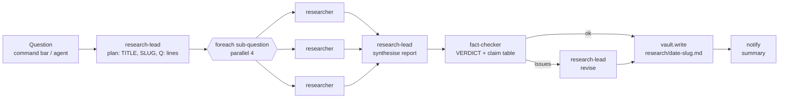

# Research — web tools, research agents and workflows

> Status: draft v0.1

Nexus researches the web with its own tools (no hosted "deep research" product needed): a search
tool backed by a search engine you choose (ideally a self-hosted **SearXNG** at home), a page
reader that turns pages into compact Markdown, and a set of agents and workflows that plan,
investigate in parallel, synthesise, fact-check and file the result in the vault.



## 1. Tools (`internal/webtools`)

All three are **READ** actions (policy level *auto* by default) and are node-local tools of the
module `tools.web` (every node, on by default). The same tools exist on the hub as module
`tools.web.hub`, for workflow `tool:` steps and for nodes without the node module (a node-local
tool wins over the hub one with the same name).

### `web.search`
Input: `{query, count? (1–20, default 8), freshness? (day|week|month|year), site?, lang?}`

Output:
```json
{"query": "...", "provider": "searxng",
 "results": [{"title": "...", "url": "https://...", "snippet": "...", "published": "2026-10-01", "source": "searxng/bing"}],
 "errors": ["brave: HTTP 429: ..."]}
```
Providers are tried in order until one returns results. URLs are cleaned (tracking parameters
such as `utm_*`, `fbclid`, `gclid` and fragments removed) and de-duplicated (scheme, `www.`,
trailing slash ignored); with `site`, off-site results are dropped.

| Provider | Needs | Notes |
|---|---|---|
| `searxng` | `base_url` of your instance | **Recommended.** Self-hosted metasearch (Google, Bing, DDG, Wikipedia, …). JSON format must be enabled. |
| `brave` | `BRAVE_API_KEY` | Brave Search API (independent index; free tier with monthly quota). |
| `tavily` | `TAVILY_API_KEY` | Search API built for LLM agents; good snippets. |
| `duckduckgo` | nothing | Scrapes `html.duckduckgo.com`. **Fallback only**: DuckDuckGo rate-limits automated clients (answers with a challenge, reported as an error) and can change its markup at any time. Requests are spaced by `min_interval` (2 s). |

### `web.fetch`
Input: `{url, max_chars? (default 40 000, max 200 000)}`

Output: `{url, final_url, status, content_type, title, byline?, published?, site_name?,
description?, lang?, text, truncated, total_chars, links:[{text,url}], cached, fetched_at, note?}`

- **HTML** → readability-style extraction in pure Go: scripts/styles/nav/footer/aside/forms,
  hidden elements and cookie/share/related/sidebar blocks are dropped; blocks are scored by
  paragraph text, commas and link density; the best block and its related siblings are kept and
  rendered as compact Markdown (headings, lists, tables, code, quotes). Title/byline/date come
  from Open Graph, JSON-LD (`NewsArticle`…) and meta tags. `links` are the main content's links
  (max 20). Charsets are decoded (e.g. ISO-8859-1).
- **Text/JSON/XML** → returned as text.
- **PDF** → a small built-in reader extracts text from simple PDFs (Flate streams, standard
  fonts); `note` says it is best-effort. Scanned/encrypted/custom-encoded PDFs return an empty
  text and a note to use the `pdf` tool.
- Pages that need JavaScript return little text (`note` suggests the `browser` agent).

### `web.extract`
Input: `{url, question, max_passages? (default 6), passage_chars? (default 800)}`

Fetches the page (same cache), splits it into ~800-character passages (keeping the nearest
heading) and ranks them with BM25 against the question (accent folding, EN/PT stopwords, light
plural stemming). Returns `{url, final_url, title, published?, passages:[{index, score,
heading, text}], total_passages, note?}`. A cheap pre-filter: an agent reads 6 passages instead
of a 40 000-character page.

### Limits and safety
| | Default |
|---|---|
| Download cap | 5 MiB (`truncated: true` beyond; larger PDFs are refused) |
| Output cap | 40 000 characters (`max_chars`) |
| Timeout | 20 s per fetch, 15 s per search, 5 redirects |
| Cache | on disk, `<data_dir>/tools.web/cache`, TTL 6 h, max 512 MiB (pruned hourly) |
| robots.txt | ignored by default (`respect_robots: true` to honour it) |

**SSRF guard.** URLs come from models (and from web pages), so `web.fetch`/`web.extract` refuse
non-http(s) URLs, URLs with credentials, and any connection to loopback, private (RFC 1918,
ULA), link-local (incl. `169.254.169.254` cloud metadata), CGNAT/Tailscale (`100.64/10`),
multicast and reserved addresses. The check runs **at connect time on the resolved IP**, so it
also covers redirects and DNS tricks (a public name resolving to `10.0.0.5`). To let agents read
something on your LAN, allow it explicitly (`allow_hosts: [wiki.lan, 192.168.1.20/32]`);
`allow_private: true` turns the guard off. Search providers are operator-configured and are
reached without the guard (your SearXNG is usually on a private address).

## 2. Configuration

Node (`node.yaml`) — section `tools.web`; hub (`nexus.yaml`) — the same keys under
`tools.web.hub`:

```yaml
tools.web:
  search:
    provider: [searxng, duckduckgo]        # fallback order
    searxng:
      base_url: http://searxng.lan:8888
      # engines: "google,bing,duckduckgo,wikipedia,brave"
      # categories: general
      # safesearch: 0
      # headers: { Authorization: "Bearer ${SEARXNG_TOKEN}" }   # if behind an auth proxy
    brave:  { api_key_env: BRAVE_API_KEY }
    tavily: { api_key_env: TAVILY_API_KEY }
    duckduckgo: { disabled: false, min_interval: 2s }
    default_count: 8
    timeout: 15s
  fetch:
    max_chars: 40000
    max_download_bytes: 5242880
    timeout: 20s
    allow_hosts: []            # LAN hosts agents may read: names, *.suffix, CIDRs
    deny_hosts: []
    allow_private: false
    respect_robots: false
    use_env_proxy: false       # route fetches via HTTP(S)_PROXY (e.g. a VPN exit)
  cache:
    ttl: 6h
    max_bytes: 536870912
```

Without `provider`, every configured provider is used in this order: SearXNG (if `base_url`),
Brave (if `BRAVE_API_KEY` is set), Tavily (if `TAVILY_API_KEY` is set), then DuckDuckGo. The
startup log line `web tools ready search_providers=…` shows the result; a warning is logged when
only DuckDuckGo is available.

### Wiring
- `cmd/nexus-node/modules.go`: `_ "github.com/danielpina1/nexus/backend/internal/webtools"`
  (registers `tools.web`, default on).
- `cmd/nexusd/modules.go`: the same import registers `tools.web.hub` (default on), needed for
  workflow `tool: web.search` steps and for nodes that don't run the node module.
- Agents get the tools by listing them: `tools: [web.search, web.fetch, web.extract, …]`.

## 3. Self-hosting SearXNG at home

SearXNG is a free, open-source metasearch engine: it queries Google, Bing, DuckDuckGo,
Wikipedia and others for you and merges the results, without accounts or API keys.

```sh
mkdir -p ~/searxng/config && cd ~/searxng
docker run -d --name searxng --restart unless-stopped \
  -p 8888:8080 -v "$PWD/config:/etc/searxng" \
  -e SEARXNG_BASE_URL=http://searxng.lan:8888/ \
  docker.io/searxng/searxng:latest
```

The first start writes `config/settings.yml`. Edit it — **the JSON API is off by default** and
Nexus needs it:

```yaml
use_default_settings: true
server:
  secret_key: "paste the output of: openssl rand -hex 32"
  limiter: false          # private instance: the bot limiter would block API clients
  public_instance: false
search:
  formats:
    - html
    - json                # required by Nexus
```

Then `docker restart searxng` and check:

```sh
curl -s 'http://searxng.lan:8888/search?q=nexus&format=json' | head -c 300
```

A `403 Forbidden` means `json` is still missing from `search.formats` (the tool's error says so
too). Tips:
- Keep it on the LAN or behind your VPN/Tailscale; don't expose an instance without the limiter
  to the internet.
- Some upstream engines (Google especially) occasionally rate-limit a single home IP; enabling
  several engines (`bing`, `brave`, `duckduckgo`, `mojeek`, `wikipedia`, `qwant`) in the
  `engines:` section keeps results flowing.
- With docker compose, the official `searxng-docker` repository adds Caddy and Valkey; Nexus only
  needs the `searxng` service.

## 4. Agents (`vault-template/agents/`)

| Agent | Model | Role |
|---|---|---|
| `researcher` | `smart` | One question: memory.search first, plan 3–6 queries, read 5–15 sources (3–5 for quick), cross-check, findings with inline `[n]` citations + sources; saves `research/YYYY-MM-DD-slug.md` when run directly. |
| `research-lead` | `best` | Plans sub-questions (plan mode), synthesises the report from [[Research report]] (synthesis mode), applies fact-check fixes (revision mode), links existing notes, proposes facts. Run directly, it starts `deep-research` via `workflow.run`. |
| `fact-checker` | `smart` | Re-reads cited sources for the claims a draft depends on; outputs `VERDICT: ok/issues`, a claim/verdict/evidence table and fixes. |
| `news-briefer` | `smart` | Topic digests; output contract `NOTABLE:` / `HEADLINE:` lines + digest (used by `watch-topic`). |
| `product-researcher` | `smart` | Specs, independent reviews, problems and current prices; recommends 1–3 options; hands buying to the `shop` agent with `spawn_agent`. |

**Why the fan-out is a workflow.** `spawn_agent` returns the child task id immediately and
there is no tool to wait for a child and read its result, so an agent cannot collect its
sub-tasks. The `deep-research` workflow does the fan-out with `foreach … parallel: 4` and passes
every researcher's findings to the synthesis step (`steps.research.result.items[*].investigate.output`).
`research-lead` may still spawn fire-and-forget sub-tasks (each reports back to you itself).

## 5. Workflows (`vault-template/workflows/`)

| Workflow | Trigger | Steps |
|---|---|---|
| `deep-research` | intent "research", "deep dive into", "pesquisa sobre"…; `workflow.run` | plan → foreach researcher (parallel 4, failures tolerated) → synthesise → fact-check (not for `quick`) → revise if issues → `vault.write research/<date>-<slug>.md` → notify with the Summary section. Inputs: `question`, `depth: quick|standard|deep`. |
| `quick-answer` | intent "quick answer", "look up", "pesquisa rápida"… | One researcher, ≤150 words with citations; Q&A appended to the daily note. |
| `watch-topic` | cron 08:00 Europe/Lisbon (disabled until you create `research/watchlist.md`) | `vault.read` the watchlist → news-briefer → append "## Watchlist" digest to the daily note (unless "Nothing new.") → notify only when `NOTABLE: yes`. |

Agent step outputs are the agent's final answer text (`steps.<id>.output`); the workflows parse
the line-based contracts (`TITLE:`, `SLUG:`, `Q:`, `VERDICT:`, `NOTABLE:`, `HEADLINE:`) with CEL
string functions, so a model that adds extra prose still works, and a plan without `Q:` lines
falls back to researching the whole question. Dry runs execute nothing that writes
(`!run.dry_run` guards).

Example: "deep dive into home batteries for a 3-bedroom house in Lisbon" →
`research/2026-10-12-home-batteries-lisbon.md` + a phone notification with the summary.

## 6. Privacy

- **SearXNG** sends your queries to the upstream engines from your home IP, without cookies or
  accounts; the engines see the queries but cannot tie them to a profile. Nothing leaves your
  network except those queries.
- **Brave / Tavily** see every query, tied to your API key. Use them as fallbacks, or not at all.
- **DuckDuckGo** fallback sees queries from your IP (no account).
- **Page fetches** go directly from the node to each site, with your IP and a
  `NexusResearch/1.0` user agent. Route them through a proxy/VPN with `use_env_proxy: true` if
  you prefer; the SSRF guard then checks resolved addresses before each request instead of at
  connect time.
- **Model provider**: page text and findings are sent to whichever model the agent uses (the
  Unify gateway alias). Use local `fast-local` aliases for topics you want to keep at home.
- **Cache**: fetched pages are stored unencrypted under the node's data dir for the TTL (6 h).
  `cache.disabled: true` turns it off.
- **Prompt injection**: web pages are untrusted. The agents are instructed to treat page text as
  data; the tools are READ-only, and everything that writes (vault notes, notifications) goes
  through normal policy. Don't give research agents `write_external`/`spend` tools.
