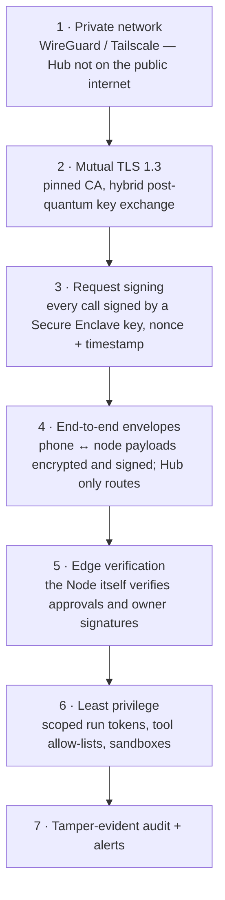
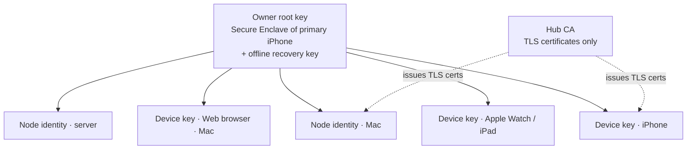

# Security Model

> Status: draft v0.2 — "ultra safe" phone ↔ machine connection.

Nexus can run code on your machines, read your email and spend your money. The connection between
the iPhone and your computers is designed so that **no single compromised component can take
control of a machine**: not the network, not Apple's push service, not even the Hub itself.

## 0. Security goals

| # | Goal |
|---|---|
| G1 | Only **your** devices can command your machines. |
| G2 | A compromised **Hub** cannot run dangerous actions on a Node, read end-to-end-encrypted payloads, or forge approvals. |
| G3 | A stolen or lost **phone** is useless without Face ID, and can be revoked remotely. |
| G4 | **Network attackers** (Wi-Fi, ISP, CDN, "middlebox") see nothing and can modify nothing. |
| G5 | **Apple / APNs** never sees notification content. |
| G6 | Every security-relevant event is recorded in a **tamper-evident** log. |
| G7 | Keys never leave secure hardware where hardware exists. |

## 1. Layers of defence



Each layer assumes the previous one may fail.

### Layer 1 — Private network

- **Recommended:** the Hub sits on the home network behind the **UniFi Gateway**; the iPhone
  reaches it through the gateway's WireGuard VPN server (on-demand) or Teleport — see
  [NETWORK.md](NETWORK.md). Tailscale/Headscale are alternatives. The Hub has **no public listening port**.
- Nodes still dial out to the Hub (ADR-0004); nothing listens on home machines.
- APNs works without exposure: the Hub only makes *outbound* connections to Apple.
- Alternative "public Hub" mode (if Tailscale is not wanted): only port 443, behind strict mTLS
  (Layer 2) — unauthenticated clients cannot complete the TLS handshake at all.

### Layer 2 — Mutual TLS 1.3 everywhere

- **TLS 1.3 only**, modern AEAD ciphers. Hybrid post-quantum key exchange (X25519 + ML-KEM) where
  both sides support it (Go's TLS stack does by default; recent iOS versions do too).
- The Hub runs a **private CA** created at `nexusd init`. Every device and Node gets a client
  certificate at pairing. No client certificate → no connection.
- Clients **pin** the Hub CA (fingerprint delivered in the pairing QR). No public CA is trusted for
  Hub connections, so a mis-issued public certificate cannot be used to intercept.
- Device/Node private keys are generated **inside secure hardware** and are non-exportable
  (§3).
- Certificates are short-lived (e.g. 30 days) and auto-renewed over the existing authenticated
  channel; revocation is immediate (Hub + Node deny-lists, see §6).

### Layer 3 — Signed requests

Even inside mTLS, every state-changing request carries a signature:

```
signature = Sign(device_key, SHA256(method || path || body_hash || timestamp || nonce || device_id))
```

- Timestamp window ±60 s and a nonce cache → **no replay**.
- Per-device monotonic counter for commands → no reordering.
- Read-only streaming (events) only needs Layer 2 + a short-lived session token.

### Layer 4 — End-to-end envelopes (phone ↔ node)

The Hub routes messages but should not have to be trusted with what flows between the phone and a
machine. Sensitive payloads travel in a **sealed envelope**:

- **Encryption:** HPKE (RFC 9180) — X25519 + HKDF-SHA256 + ChaCha20-Poly1305 — to the recipient's
  encryption key (the Node's, or the phone's).
- **Signature:** the sender signs the envelope (P-256 ECDSA from the Secure Enclave on iOS).
- **Binding:** envelope header contains sender, recipient, purpose, timestamp, nonce, and
  (for approvals) the hash of the exact action; it is authenticated as AAD.

Used for: commands to a Node (shell, files, terminal), file transfers, approval decisions,
notification contents, secret entry from the phone ("paste API key into node X").

What the Hub still sees: metadata (who talks to which node, when, sizes) and anything the Hub itself
must process (routing input, vault content when the Hub hosts the vault — see §7 for the
"Hub at home" option that removes this).

### Layer 5 — Edge verification (zero-trust Hub)

The most important rule: **the Node decides, not the Hub.**

- At pairing, each Node receives the **owner root public key** and the list of authorised device
  keys, signed by the owner root key (§2). The Node stores them locally.
- Before executing any action of class `code_push`, `spend`, `destructive`, `write_external` or a
  direct terminal/shell command from a user, the **Node verifies**:
  1. a valid **approval signature** from an authorised device over `(challenge || action_hash)`,
  2. that `action_hash` matches the action it is about to execute,
  3. that the signing device is not revoked and the signature is fresh.
- Therefore a compromised Hub can at most: delay or drop messages, see metadata, start runs of
  *existing* agents with *auto-level* tools inside their sandboxes. It **cannot** push code, spend,
  delete, send email, or open a shell on your PC.
- Changes to **agents and policies** that loosen permissions must be signed by a device as well;
  Nodes refuse agent specs whose policy is looser than the last owner-signed policy.

### Layer 6 — Least privilege

- **Run tokens:** scoped to one run, its agent's tools, its node, and its lifetime.
- **Tool allow-lists** per agent (the grocery agent cannot run shell commands).
- **Workspaces/sandboxes** per run; optional rootless containers with no network unless needed.
- **Secrets stay on the Node** that uses them; redacted from all event streams.
- The Node runs as an unprivileged user; elevated actions go through a separate, explicitly
  configured helper with its own allow-list.

### Layer 7 — Audit and alerts

- The event log is **hash-chained** (each entry includes the hash of the previous one) and
  periodically **checkpoint-signed** by the Hub and mirrored to the Nodes → tampering is detectable.
- Nodes keep their own local log of everything they executed, with the verifying signature.
- Immediate alerts (time-sensitive push to all devices) on: new device paired, new Node paired,
  certificate issued, failed signature/approval verification, policy loosened, kill switch used,
  login from a new network.

## 2. Key hierarchy



| Key | Where | Purpose |
|---|---|---|
| **Owner root key** | Secure Enclave of the primary iPhone (Face ID required) | Signs device and node enrolments and policy changes. The real authority — not the Hub. |
| **Recovery key** | Offline: printed QR / passphrase, or a hardware security key (YubiKey) | Recover if the primary iPhone is lost; re-sign a new root. |
| **Device auth key** | Secure Enclave, no biometry | Signs requests (Layer 3), mTLS client key. |
| **Device approval key** | Secure Enclave, **biometry-bound** (invalidated if Face ID enrolment changes) | Signs approvals and owner actions. |
| **Device encryption key** | Keychain (X25519) | Receives HPKE envelopes and encrypted notifications. |
| **Node identity key** | macOS: Secure Enclave via Keychain · Linux: TPM 2.0 if present, else 0600 encrypted file | mTLS, signs node logs, receives envelopes. |
| **Hub CA key** | Hub (encrypted at rest) | Issues short-lived TLS certificates only. Cannot authorise actions. |

## 3. Pairing (in person, verified)

### Phone ↔ Hub
1. `nexusd pair --device` (or the web Security page) shows a QR containing: Hub address(es),
   Hub CA fingerprint, a one-time pairing secret (valid 5 min, single use), Hub public key.
2. The iPhone generates its keys in the Secure Enclave and proves it is a **genuine Nexus app on a
   genuine iPhone** with **App Attest**.
3. It sends its public keys, signed with the pairing secret (PAKE-style binding so a network
   attacker who did not scan the QR cannot complete pairing).
4. Both screens show a **6-emoji safety code** derived from both public keys; you confirm they match.
5. On the first device, the owner root key is created and signs this device. Later devices must be
   approved (Face ID) from an existing device.

### Node ↔ owner
1. `nexus-node pair` prints a code / QR in the terminal.
2. You scan it with the iPhone → emoji safety code on both → **Face ID** → the owner root key signs
   the Node's identity and the Hub issues its TLS certificate.
3. The Node stores the owner root public key; from now on it only obeys owner-signed authority.

Pairing is **off by default** and only enabled for 5 minutes on demand; every pairing triggers an
alert on all existing devices.

## 4. iPhone app hardening

- Keys only in Secure Enclave / Keychain (`ThisDeviceOnly`, never synced to iCloud).
- App lock: Face ID on open (configurable timeout); blur in the app switcher.
- Local cache encrypted with Data Protection class *Complete*.
- **Notification contents are end-to-end encrypted**: the Hub sends `mutable-content` pushes whose
  payload is an HPKE envelope; the Notification Service Extension decrypts it on-device. Apple sees
  only "Nexus — new notification".
- Live Activity payloads contain no sensitive text by default (ids, progress, counts); a
  per-category setting chooses what may appear on the Lock Screen.
- Approval buttons on notifications/Live Activities require an unlocked device; biometric approvals
  always open the in-app sheet with Face ID and an exact preview of what is being approved.
- App Attest assertion on sensitive requests; jailbreak/debugger signals raise risk and force
  biometric for everything.
- Certificate pinning and no fallback to plain HTTP, ever.

## 5. Approvals: what you see is what you sign

1. The Node (or Hub for hub-side actions) computes `action_hash` over the canonical action
   (e.g. cart items + total + delivery slot; or git remote + branch + commit SHA).
2. The phone receives the action preview **inside an encrypted envelope from the Node** and
   recomputes the hash itself.
3. Face ID unlocks the approval key; the phone signs `(challenge || action_hash || expiry)`.
4. The Node verifies the signature and that the hash matches exactly what it will execute.
   Changing a single item or cent invalidates the approval.

## 6. Revocation and recovery

- **Revoke a device** from any other device (Face ID) or with the recovery key; the revocation is
  owner-signed and pushed to the Hub **and every Node**, which refuse that key immediately.
- **Lost primary iPhone:** use the recovery key on a new phone to create a new owner root;
  everything signed by the old root is re-signed or revoked.
- **Kill switch:** cancels all runs, pauses all triggers, revokes all run tokens; Nodes enter
  "locked" mode until an owner-signed unlock.
- **Duress lock (optional):** a specific gesture/passcode in the app triggers the kill switch silently.

## 7. Deployment options by trust level

| Mode | Hub location | What a Hub compromise exposes |
|---|---|---|
| **Fortress (recommended)** | Hub on a home machine behind the UniFi Gateway; phone over the UniFi WireGuard VPN / Teleport (or Tailscale) — see NETWORK.md | Requires breaking into your private network first. |
| **Blind relay** | Brain (Hub) at home; a VPS only relays encrypted traffic and sends APNs | VPS sees only encrypted envelopes and metadata. |
| **Cloud Hub** | Hub on a VPS | Metadata + vault content on that VPS (encrypt disk); still **cannot** command Nodes dangerously (Layer 5). |

## 8. Supply chain

- Release binaries are signed; Nodes verify signatures before self-update and only accept updates
  approved (signed) from your device.
- Reproducible builds; pinned dependencies (`go.sum`, lockfiles); `govulncheck` and dependency
  review in CI.
- iOS app distributed via TestFlight/App Store signing only.

## 9. Prompt-injection posture

Agents read untrusted content (web pages, emails, shared files). Mitigations:

- Untrusted content is tagged in context; external/spend/destructive actions always go through
  policy and **edge-verified approvals**, regardless of what the model decides.
- Per-agent tool allow-lists keep the blast radius small.
- Suspicious instructions found in content are surfaced in the run view.

## 10. Threat model

| Threat | Mitigation |
|---|---|
| Network attacker / malicious Wi-Fi | Private network + mTLS 1.3 + CA pinning + E2E envelopes. |
| Mis-issued public TLS certificate | Public CAs not trusted for Hub connections (pinned private CA). |
| Compromised Hub | Edge verification on Nodes; owner root key not on the Hub; E2E envelopes; signed policies. |
| Compromised Node | Can only affect that machine; its cert is revocable; no other Node's secrets are sent to it. |
| Stolen phone | Secure Enclave keys, Face ID for approvals and app open, remote revoke, recovery key. |
| Cloned/fake app | App Attest at pairing and on sensitive requests. |
| Replay of a captured request/approval | Nonces, timestamps, counters, action-hash binding, expiry. |
| Apple/APNs visibility | Encrypted notification payloads, minimal Live Activity content. |
| Malicious content → agent | Tool allow-lists, policy outside the model, approvals verified on the Node. |
| Runaway costs | Budgets with hard stops, cost events, alerts. |
| Malicious update | Signed binaries + owner-approved updates. |
| Log tampering | Hash-chained, signed, mirrored audit log. |

## 11. Implementation notes (Go / Swift)

- Go: `crypto/tls` (TLS 1.3, hybrid PQ key exchange), `crypto/ecdsa` (P-256), `crypto/hpke` or a
  vetted HPKE package, `crypto/x509` for the private CA; no custom cryptography.
- Swift: CryptoKit (`SecureEnclave.P256.Signing`, `HPKE`, `Curve25519`), `LocalAuthentication`,
  `DeviceCheck` (App Attest), `URLSession` with client identity + pinning.
- Formats: signed envelopes as Protobuf (`SealedEnvelope`, see `proto/nexus/v1/security.proto`).
- External security review before Nexus controls real money or production servers.
