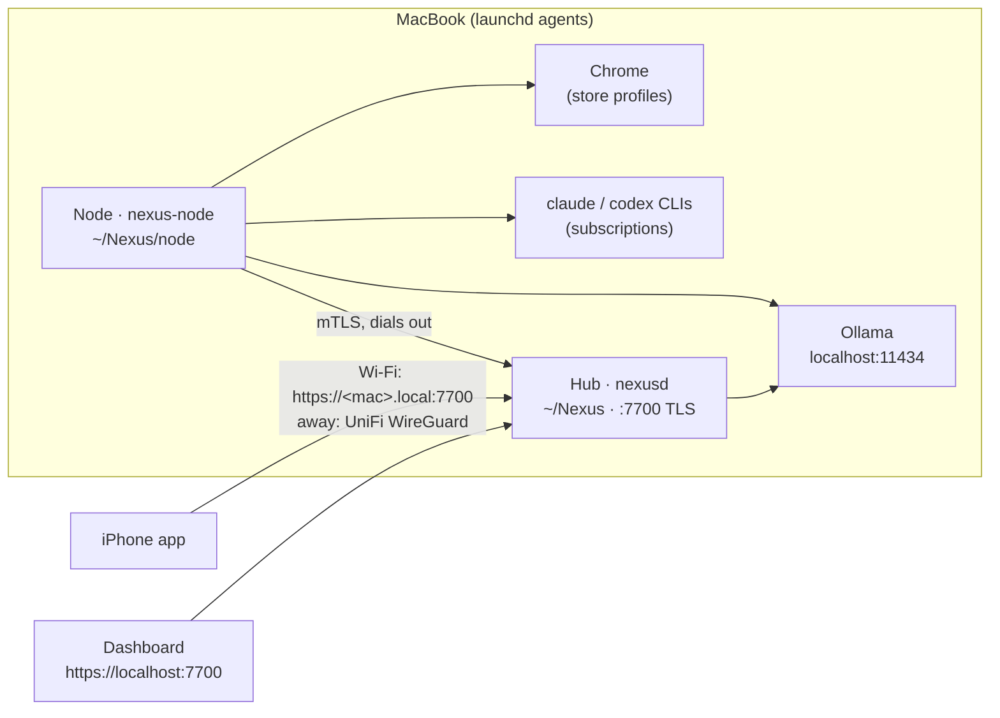

# Day 1 on your MacBook

This guide sets up all of Nexus on one Apple Silicon MacBook: the **Hub** (`nexusd`), a
**node** (`nexus-node`) that runs agents on the Mac, **Ollama** for local models, **Chrome** for
the shopping agent, your **Claude and ChatGPT subscriptions** through the Claude Code and Codex
CLIs, and the **iPhone app** built with Xcode. Later the Hub can move to an always-on machine at
home and the MacBook stays a node ([§11](#11-moving-the-hub-to-another-machine)).



| What | Where |
|---|---|
| Hub config, vault, data | `~/Nexus/nexus.yaml`, `~/Nexus/vault/`, `~/Nexus/data/` |
| Node config and data | `~/Nexus/node/node.yaml`, `~/Nexus/node/data/` (pairing credentials, browser profiles) |
| Binaries | `~/.nexus/bin/` (`nexusd`, `nexus-node`, `nexus`, `nexus-browser-login`) |
| Logs | `~/Library/Logs/Nexus/hub.log`, `node.log` |
| Services | `~/Library/LaunchAgents/com.nexus.hub.plist`, `com.nexus.node.plist` |
| Config profile | [`backend/configs/macbook/`](../backend/configs/macbook/) (`nexus.yaml`, `node.yaml`) |

## 1. Before you start

- macOS 15 or later on Apple Silicon (Intel works; local models are slower), 16 GB of memory or
  more (24 GB+ for the larger local model), ~25 GB free disk (Xcode ~10 GB, models 5–15 GB).
- **Homebrew** — <https://brew.sh>. The setup script prints the install command but never runs
  it for you.
- **Xcode** from the Mac App Store (only for the iPhone app; the Hub does not need it). Open it
  once so it installs the iOS platform.
- A **Claude** (Pro/Max) and/or **ChatGPT** (Plus/Pro) subscription. No API keys are needed.
- This repository cloned somewhere, e.g. `~/src/nexus`.

## 2. Run the setup script

```sh
cd ~/src/nexus
scripts/mac/setup.sh --dry-run     # read the plan first: nothing is changed
scripts/mac/setup.sh               # or: make mac-setup
```

It explains each step and asks before installing or downloading anything (`--yes` answers yes
to everything; `--skip-models`, `--skip-services`). It is safe to run again: existing configs,
the vault and the pairing are kept. In order, it:

1. checks macOS, the architecture and the memory;
2. checks Homebrew and offers `brew install go node buf ollama xcodegen` for what's missing;
3. offers `brew install --cask google-chrome` when Chrome is missing;
4. checks Xcode (`xcode-select -p`) and tells you what to do if it is missing;
5. checks the `claude` and `codex` CLIs and prints the official install and login commands (§3);
6. builds the binaries into `~/.nexus/bin` and the dashboard into `web/dist`;
7. creates the Hub in `~/Nexus`: `nexus.yaml` from the MacBook profile with a fresh random dev
   token and the Hub URLs `https://nexus.home.arpa:7700` and `https://<your-mac>.local:7700`
   (from `scutil --get LocalHostName`), then `nexusd init` copies the starter vault, which it
   offers to put under git;
8. writes `~/Nexus/node/node.yaml` (node id `macbook`, tags `mac, dev, browser`);
9. starts Ollama (`brew services start ollama`) and offers to pull the local models (§4);
10. **pairs the node with the Hub** for real (`nexusd pair -kind node` → `nexus-node pair`),
    so the node uses mTLS with the pinned Hub CA — no shared secrets in config files;
11. runs `nexusd llm check` and `nexus-node llm check`, and lists the runtimes;
12. installs and starts the launchd agents (§10);
13. prints the dashboard URL, how to pair the iPhone, and the UniFi checklist.

Add `~/.nexus/bin` to your `PATH` (`~/.zshrc`): `export PATH="$HOME/.nexus/bin:$PATH"`.

## 3. Log in to Claude Code and Codex (your subscriptions)

The `claude-code` and `codex` runtimes run the official CLIs on the node, so they use whatever
account the CLI is logged in with. Install them with the official method (check the current
instructions in each tool's docs):

| CLI | Install (official options) | Log in once |
|---|---|---|
| Claude Code | `curl -fsSL https://claude.ai/install.sh \| bash` (native, to `~/.local/bin`) or `npm install -g @anthropic-ai/claude-code` | run `claude`, then `/login` and choose your Claude subscription |
| Codex | `npm install -g @openai/codex` or `brew install --cask codex` | `codex login` → **Sign in with ChatGPT** |

Then check that the node sees them:

```sh
nexus-node runtimes -config ~/Nexus/node/node.yaml     # claude-code / codex: AVAILABLE true
scripts/mac/service.sh restart node                     # after installing a CLI
```

- Do **not** set `ANTHROPIC_API_KEY` or `OPENAI_API_KEY` for the node: with a key the CLIs bill
  the API instead of your subscription. The launchd agents only get the environment in their
  plist, not your shell's.
- Subscription plans have usage limits; when one is reached the run fails with the CLI's
  message. Local models keep working.

## 4. Local models (Ollama)

The Hub uses local models for the command router, memory and vault Ask; native agents on the
node use them too. The MacBook profile pins two models and lets the others be picked
automatically ([MODELS.md](MODELS.md)):

| Alias | Model | Download | Used for |
|---|---|---|---|
| `fast-local` | `qwen2.5:7b` | ~4.7 GB | router classifier (needs JSON mode), quick answers |
| `embed` | `nomic-embed-text` | ~0.3 GB | vault semantic search |
| `smart` / `best` | auto (e.g. `qwen2.5:14b`, ~9 GB, offered on 24 GB+ Macs) | — | local agents |

```sh
ollama list                                   # what you have
ollama pull qwen2.5:14b                       # add a bigger model any time; smart picks it up
nexusd llm check -config ~/Nexus/nexus.yaml   # chat, tool calling, JSON, streaming, embeddings
nexus-node llm check -config ~/Nexus/node/node.yaml
```

Keep `embed` pinned once the vault is indexed (vectors from different models don't mix).

## 5. Open the dashboard

Open **<https://localhost:7700>**. The certificate comes from your Hub's own private CA, so the
browser warns once — continue to the site. In **Settings**, paste the dev token
(`grep dev_token ~/Nexus/nexus.yaml`). Try the command bar: "hello" with the echo agent.

From the terminal:

```sh
export NEXUS_URL=https://localhost:7700 NEXUS_CA_FILE=~/Nexus/data/security/pki/ca.crt
export NEXUS_TOKEN=<dev token>
nexus run "hello ?approve" -agent echo -follow
```

The dev token grants full access: once the iPhone (and the browser) are paired, remove
`security.dev_token` from `nexus.yaml` and restart the Hub.

## 6. Build the iPhone app and pair it

```sh
scripts/mac/ios-build.sh          # or: make ios
```

It checks Xcode 16.3+ and XcodeGen, asks for your **Team ID** and a **bundle id prefix** and
writes them to `ios/Config/Local.xcconfig` (git-ignored), runs the Go and Swift wire-format test
vectors (the NexusKit tests run on an iOS Simulator, because the package uses iOS-only
frameworks), runs `xcodegen generate` and opens `ios/Nexus.xcodeproj`. In Xcode choose the
**Nexus** scheme and your iPhone, then **Run**. The first time, turn on **Developer Mode** on the
iPhone (Settings → Privacy & Security).

**Apple Developer account.** The Simulator needs no account. On a real iPhone:

| | Free Apple ID (Personal Team) | Apple Developer Program (paid) |
|---|---|---|
| Install on your iPhone | yes, but the profile expires after **7 days** (Run again from Xcode) | yes, 1-year profiles, TestFlight |
| Push notifications, approval alerts, Live Activity push | **no** — the Push Notifications capability is not available | yes |
| Signing this project as is | fails: the targets declare `aps-environment` and time-sensitive / communication notifications; remove those keys from the `.entitlements` files to try with a free team | works |
| App Groups, Keychain sharing (widgets/extensions share the pairing) | Xcode tells you if your team can't use them | yes |
| Face ID, Secure Enclave keys | yes | yes |

Start with the Simulator or a free team if you like; enrol in the paid program when you want
approvals on the lock screen. For push, the Hub then needs an APNs key: see the `notify`
section of `~/Nexus/nexus.yaml` (keep the `.p8` file outside the repo, e.g. `~/Nexus/secrets/`).

**Pair** at home on Wi-Fi:

```sh
nexusd pair -config ~/Nexus/nexus.yaml        # or dashboard → Settings → Pair a device
```

Scan the QR in the app and check that both screens show the same 6-emoji safety code. The QR
holds both Hub URLs; at home the app uses `https://<your-mac>.local:7700`.

## 7. Log in to shops once

Each store keeps its login in its own Chrome profile on the node ([SHOPPING.md](SHOPPING.md)).
Log in once per store, while no shopping run is using that store:

```sh
nexus-browser-login -data-dir ~/Nexus/node/data -profile continente -url https://www.continente.pt/
nexus-browser-login -data-dir ~/Nexus/node/data -profile worten     -url https://www.worten.pt/
```

Log in, tick "remember me", close the window. Agents never type passwords or card numbers.

The MacBook node is tagged `[mac, dev, browser]`, which is enough for every starter agent
(the shop agents need `browser`, code-fixer needs `dev`). To watch the browser while you get
started, set `runtime.browser.headless: false` in `~/Nexus/node/node.yaml`, then
`scripts/mac/service.sh restart node`.

## 8. Reach Nexus from anywhere (UniFi VPN)

Follow [NETWORK.md](NETWORK.md). For a Hub on the MacBook:

- [ ] UniFi → the MacBook's client page → **Fixed IP** (on Wi-Fi the MacBook may use a private
      Wi-Fi address per network: System Settings → Wi-Fi → your network → Details → Private
      Wi-Fi address: **Fixed** or Off, so the fixed IP sticks)
- [ ] Local DNS record `nexus.home.arpa` → that IP (already in your pairing QR)
- [ ] WireGuard VPN server + iPhone WireGuard client with **On-Demand** (or Teleport)
- [ ] Firewall: allow TCP 7700 to the MacBook from the home LAN and VPN clients
- [ ] If the macOS firewall is on, allow `nexusd` to accept incoming connections (macOS asks;
      after a rebuild it may ask again)
- [ ] Test once on cellular with the VPN on

`server.listen` is `0.0.0.0:7700`, so the Hub also listens on other networks the laptop joins
(a café's Wi-Fi). Every call still needs TLS and a paired device or the dev token — one more
reason to remove the dev token after pairing.

## 9. Sleep, the lid and the battery

The Hub only runs while the MacBook is awake. **Lid closed = Hub offline**: the iPhone shows
"Can't reach your Nexus at home", queues commands and signed approvals, and sends them when the
Hub is back; the node reconnects by itself on wake.

- Keep it awake while plugged in: System Settings → Battery → Options → **Prevent automatic
  sleeping on power adapter when the display is off**.
- For a while, from a terminal: `caffeinate -is` (until Ctrl-C) or `caffeinate -is -t 7200`.
- Lid closed only stays awake in clamshell mode (power + external display). Don't force a
  closed laptop awake in a bag.
- Runs in progress (Claude Code, shopping) pause or fail when the Mac sleeps; check the task
  and retry it if needed.

This is the main reason to move the Hub to an always-on machine later (§11).

## 10. Daily use

```sh
scripts/mac/service.sh status          # both agents + /healthz
scripts/mac/service.sh logs            # follow hub.log and node.log
scripts/mac/service.sh restart node    # after editing node.yaml or installing a CLI
scripts/mac/service.sh stop            # until the next login / start
make mac-services                      # re-install the agents (e.g. after moving the repo)
```

The agents start at login and restart after a crash. To update Nexus: `git pull`, then
`scripts/mac/setup.sh` (rebuilds, keeps your data) and `scripts/mac/service.sh restart`.

For development, `make run-local` runs a throw-away Hub + node in the foreground on port 7701
(MacBook profile in a temp directory, node paired automatically), next to the real one.

## 11. Moving the Hub to another machine

When an always-on machine (Mac mini, Linux box) joins:

1. Stop the Hub on the MacBook: `scripts/mac/service.sh stop hub`.
2. Copy `~/Nexus/nexus.yaml`, `~/Nexus/data/` and `~/Nexus/vault/` to the new machine (the
   `data/security` folder holds the Hub CA and keys: copy it privately, e.g. with `scp`). Keeping
   the CA means paired devices keep trusting the Hub.
3. On the new machine, edit `nexus.yaml`: `server.listen` to its fixed IP (NETWORK.md),
   `security.hub_urls` / `server_names` (drop `<macbook>.local`, add the new name if you like),
   `server.web_dir`, and the Ollama `base_url` if models live elsewhere. Start `nexusd serve`.
4. In UniFi, point `nexus.home.arpa` at the new machine's IP. The iPhone already knows that URL
   and the CA, so it should reconnect without re-pairing (re-pair if it doesn't).
5. Re-pair the MacBook node with the new Hub: on the Hub `nexusd pair -kind node`, on the
   MacBook `nexus-node pair -config ~/Nexus/node/node.yaml '<nexus://pair URL>'`, then
   `scripts/mac/service.sh uninstall hub` and `scripts/mac/service.sh restart node`. Give the new
   machine the `always-on` tag and remove it from the MacBook.

On macOS 15+, a node started by launchd that connects to a Hub on the LAN may need
**System Settings → Privacy & Security → Local Network** permission for `nexus-node`.

## 12. Troubleshooting

| Symptom | Check / fix |
|---|---|
| Hub not running | `scripts/mac/service.sh status`, then `scripts/mac/service.sh logs hub`. A config error is printed at the top of `hub.log`. |
| `address already in use` | Another Hub (e.g. a terminal `nexusd serve`, or `run-local` on 7700): `lsof -nP -iTCP:7700 -sTCP:LISTEN`. |
| Node `connection refused` / TLS errors | Is the Hub up? `node.hub_url` must be `https://localhost:7700`; `node/data/node/hub-ca.crt` must exist. To re-pair, move `~/Nexus/node/data/node` away and run `setup.sh` again. |
| `claude-code` / `codex` unavailable | `nexus-node runtimes -config ~/Nexus/node/node.yaml`. The launchd PATH is fixed at install: after installing a CLI elsewhere run `make mac-services`, or set `runtime.claudecode.binary` / `runtime.codex.binary` to the absolute path (`which claude`). |
| Claude Code asks to log in / 401 inside runs | Run `claude` once in Terminal and `/login`; make sure no `ANTHROPIC_API_KEY` is set in `node.yaml` (`runtime.claudecode.env`). The login lives in your Keychain, which launchd agents can use while you are logged in. |
| Codex not logged in | `codex login` (Sign in with ChatGPT); `codex login status`. |
| Claude Code works in Terminal but not from the Nexus service | The background service may not see your login. Run `claude setup-token`, then add `CLAUDE_CODE_OAUTH_TOKEN` to the `EnvironmentVariables` of `~/Library/LaunchAgents/com.nexus.node.plist` (that file is only readable by you), and `scripts/mac/service.sh restart node`. |
| A runtime still shows unavailable after logging in | Nexus checks runtimes when the node connects: `scripts/mac/service.sh restart node`. |
| "Claude usage limit reached" | Nexus automatically moves the task to Codex (then Ollama). It resumes using Claude after the limit resets. |
| `llm check` fails, `connection refused` | Ollama isn't running: `brew services list`, `brew services restart ollama`. |
| alias `model … is not served` | `ollama pull qwen2.5:7b` / `nomic-embed-text`, or change the pinned models in both YAML files. |
| Browser runs fail: no Chrome | Install Chrome (`brew install --cask google-chrome`) or set `runtime.browser.chrome_path`. |
| iPhone can't reach the Hub at home | Same Wi-Fi? Try `https://<your-mac>.local:7700/healthz` in Safari on the phone (expect a certificate warning). UniFi client isolation / a guest network blocks it. macOS firewall: allow `nexusd`. |
| iPhone works at home, not away | The VPN: NETWORK.md §2.2 (On-Demand, DNS through the gateway, firewall rule for the VPN subnet). |
| Everything stops at night | The MacBook slept (§9). |
| Start over | `scripts/mac/service.sh uninstall`, move `~/Nexus` away, run `setup.sh` again (re-pair the iPhone). |

## Test it (one command)

```bash
make mac-selftest          # or scripts/mac/selftest.sh [--skip-subscriptions] [--skip-ios]
```

Installs nothing and leaves `~/Nexus` alone: it runs a temporary Hub + node on port 7702 and
checks backend tests, the dashboard build, TLS pairing, an echo task, a shell task that waits
for approval, the runtimes, Ollama, one tiny prompt through **Claude Code** and one through
**Codex** (your subscriptions), and that the **iPhone app compiles** for the Simulator plus the
NexusKit wire-format tests. The report is saved as `~/Nexus-selftest-<time>.txt`
(`pbcopy < ~/Nexus-selftest-*.txt` to paste it into a chat).

The `server-watchdog` workflow ships **disabled**: on a laptop every wake-up looks like the
machine went offline. Enable it (`enabled: true` in `vault/workflows/server-watchdog.md`) once
an always-on machine joins.
