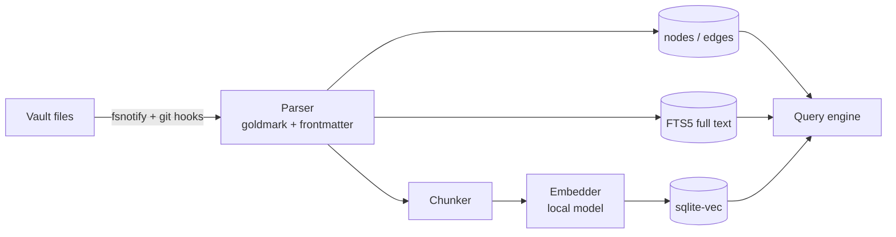
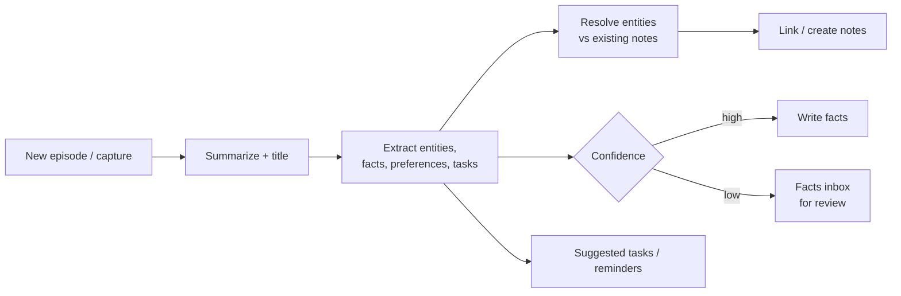

# Vault — Knowledge Base and Memory

> Status: draft v0.1

The vault is Nexus's long-term memory. It is a **folder of Markdown files in a git repo**, fully
compatible with Obsidian. Nexus indexes it into a graph with full-text and semantic search, and every
agent can read and write it through the same tools.

## 1. Principles

- **Files are the truth.** The SQLite index is a cache; delete it and it rebuilds.
- **Obsidian-compatible.** YAML frontmatter, `[[wikilinks]]`, `[[note#heading]]`, `![[embeds]]`,
  `#tags`, `_attachments/`. Open the vault in Obsidian at any time.
- **Agents are first-class authors.** Every agent write is a git commit with the run id, so you can
  see and revert what any agent changed.
- **Raw first, refined later.** Captures land immediately as raw notes; enrichment is async.
- **You stay in control of facts.** Uncertain facts go to a review queue instead of silently
  becoming "truth".

## 2. Folder layout

```
vault/
├── inbox/            # raw captures waiting for processing
├── daily/            # daily notes (brief, log of what happened)
├── episodes/         # what happened: task runs, meetings, orders, conversations
├── people/           # entity notes
├── projects/
├── places/
├── products/
├── topics/           # concepts, research
├── resources/        # articles, PDFs, links (summaries + source)
├── finance/
├── agents/           # agent definitions (see AGENTS.md)
├── workflows/        # workflow definitions (see WORKFLOWS.md)
├── policies/         # trust levels, budgets, model aliases
├── templates/        # note templates (daily.md, weekly.md drive periodic notes)
├── _attachments/     # images, PDFs, audio, screenshots (content-deduplicated)
├── .trash/           # deleted files, restorable (Obsidian's trash folder too)
└── .nexus/           # writer lock + write-ahead journal (never synced/committed)
```

Folders are conventions, not rules — the `type` in frontmatter is what matters.

## 3. Note types (frontmatter)

Common fields on every note:

```yaml
id: 01JABCD...          # ULID, stable even if the file is renamed
type: person            # person | project | place | product | topic | resource | episode | daily | agent | workflow | policy | fact
title: João Silva
aliases: [João]
tags: [work]
created: 2026-10-11T21:00:00Z
updated: 2026-10-11T21:00:00Z
source: ios-share | agent:grocery-continente | obsidian | email | ...
```

| Type | Extra fields |
|---|---|
| `person` | `email`, `phone`, `company: "[[ACME]]"`, `relationship`, `birthday` |
| `project` | `status`, `repo`, `machines: ["[[mac-studio]]"]`, `agents` |
| `product` | `store`, `brand`, `size`, `usual_qty`, `price_history` |
| `episode` | `when`, `task_id`, `agent`, `participants`, `outcome`, `cost` |
| `resource` | `url`, `author`, `summary`, `read: true/false` |
| `fact` | `subject`, `predicate`, `object`, `valid_from`, `valid_to`, `confidence`, `status: proposed/confirmed/rejected` |

### Typed relations

Plain `[[links]]` become untyped `links_to` edges. Typed relations come from frontmatter keys whose
values are links, or from inline fields:

```markdown
---
type: person
works_at: "[[ACME]]"
knows: ["[[Maria]]"]
---
Prefers:: [[Delta coffee]]
```

## 4. Index and graph



- **nodes:** one per note (+ per heading block for long notes), with type and properties.
- **edges:** `(src, dst, type, valid_from, valid_to, source)`.
- **FTS5:** title, aliases, body, tags.
- **vectors:** chunk embeddings from a local embedding model.
- Index updates are incremental (file hash per note).

### Retrieval (`memory.search`)

1. Full-text + vector search in parallel → candidates.
2. **Graph expansion:** pull 1–2 hops of neighbours of the top candidates (people, projects,
   products linked to them).
3. Rerank (local model or reciprocal-rank fusion) with recency and type boosts.
4. Return snippets with note links so every answer cites its sources.

## 5. Memory pipeline

Runs async on a cheap local model; heavy work can be escalated.



- **Episodic memory:** `episodes/` — what happened, linked to everything involved.
- **Semantic memory:** entity notes + `fact` notes/fields — what is true (with time validity).
- **Preferences:** facts about you ("prefers lactose-free milk"), editable on the phone.
- **Procedural memory:** agent playbooks and "Lessons learned" sections.

When a fact changes ("moved to Lisbon"), the old one gets `valid_to` instead of being deleted, so
"where did I live in 2025?" still works.

## 6. Sync

- The Hub owns the canonical git repo and auto-commits (batched) agent and app writes.
- Desktop machines can run `nexus-node --vault-sync` to keep a local clone for Obsidian; edits are
  committed and pushed automatically; the Hub reindexes on pull.
- Conflicts: line-level three-way merge; if it fails, both versions are kept
  (`<note> (conflict YYYY-MM-DD HHMM).md`) and an inbox Notice is raised (§8.5).
- iOS keeps an offline cache (recent + pinned notes) and queues writes.
- Optional: client-side encryption for a private remote.

## 7. MCP surface

The Hub's MCP server exposes the vault to any MCP client (Claude Code, Codex, Claude Desktop,
Anthrex if it speaks MCP):

| Tool | Args |
|---|---|
| `memory_search` | `query`, `types?`, `limit?`, `since?` |
| `vault_read` | `path` or `id` |
| `vault_write` | `path`, `content` or `patch`, `message` |
| `vault_link` | `from`, `to`, `relation?` |
| `graph_neighbors` | `id`, `depth?`, `relation?` |
| `facts_propose` | `subject`, `predicate`, `object`, `confidence` |
| `daily_append` | `text` |

## 8. Durability and trust

Everything below is implemented in `backend/internal/vault` unless marked *designed*.

### 8.1 Crash-safe writes and the single-writer lock

- **Atomic files.** Every write goes to `.nexus-tmp-*` in the destination folder, is fsynced,
  renamed over the target, and then the **directory is fsynced** too (new folders are fsynced up
  the chain). A crash leaves the old or the new file, never a torn one. Leftover temp files are
  reported by Check (`temp_file`) and removed by Repair (when older than 10 minutes).
- **Write-ahead journal** for multi-file operations (rename with link updates, merge, split,
  trash/restore): the new contents are staged in `.nexus/journal/<id>/N.data`, then
  `manifest.json` (the commit point) is written atomically, then the operations are applied and
  the journal is removed. Every operation is idempotent (`write` = atomic replace from the staged
  copy, `move` = rename unless already done, `delete` = remove if present), so on the next open a
  committed journal is **rolled forward**; a journal without a manifest (crash before the commit
  point, nothing applied) is discarded. Backups include the journal, so a backup taken mid-way is
  completed on restore.
- **Single writer.** `Open` takes an exclusive `flock(2)` on `<vault>/.nexus/lock` (non-blocking;
  the PID is written for diagnostics). A second hub on the same vault fails with `ErrLocked`
  ("locked by another process (pid N …)"). The kernel drops the lock when a process dies, so there
  are no stale locks. Read-only tools (`nexusd vault check`) open with `NoLock`. On non-unix
  platforms the lock is advisory only. `.nexus/` contains a `.gitignore` of `*`.
- In-process, one mutex serialises read-modify-write of files; the SQLite index has its own writer
  lock.

### 8.2 Versioning and undo

- **git vaults:** every change is a commit (batched by `commit_delay`, with `Nexus-Run:` trailers).
  `History(path)` = `git log --follow` (renames followed; pending batched writes are flushed
  first), with unified diffs computed by the vault (so encrypted notes show decrypted diffs).
  Commits only ever include the vault's own paths; a path that vanished before the batch commit
  no longer breaks the batch.
- **no git:** a local **snapshot store** under `<data dir>/vault/snapshots/` keeps the bytes of
  every version (content-addressed `objects/ab/<sha256>`, ciphertext for encrypted notes) plus an
  append-only `log.jsonl` (fsynced per entry; a torn last line is ignored). The first change to a
  pre-existing file stores the original too; external edits (Obsidian) seen by the watcher are
  recorded as "edited outside Nexus". Retention: `snapshot_keep` versions per note (default 50),
  compacted on open. Version ids are `snap:<sha256>`.
- `GetVersion(path, commit)` / `RestoreVersion(path, commit)` write an old version back **as a new
  change** (so a restore is itself undoable). Restoring a renamed note follows its history.
- **Trash:** `DeleteNote` moves the file to `.trash/<item id>/<original path>` with
  `.trash/<item id>.json` (`{id, path, title, deleted_at, size, run_id}`); with git the deletion is
  also a commit. `RestoreFromTrash(id, path?)` puts it back (a free name like `Note-2.md` is chosen
  when the path is taken). Items older than `trash_days` (default 30) are purged daily at 04:10;
  `PurgeTrash` purges by id or age. `.trash/` holds a `.gitignore` of `*`.

### 8.3 Integrity: Check and Repair

`Check(full)` returns a report of issues `{kind, severity, path, detail, fixable, related_paths}`:

| kind | severity | quick | full | Repair |
|---|---|---|---|---|
| `pending_journal` | error | ✓ | ✓ | completes it |
| `duplicate_id` | error | ✓ | ✓ | oldest note keeps the id; others get a new id + `previous_id` |
| `index_missing` / `index_orphan` | warning | ✓ | ✓ | re-sync |
| `temp_file` | warning | ✓ | ✓ | removed (>10 min old) |
| `conflict_copy` | warning | ✓ | ✓ | — (merge by hand) |
| `index_stale` | warning | | ✓ | re-sync |
| `invalid_frontmatter` | warning | | ✓ | — (never touched) |
| `unreadable` (I/O, decryption) | error | | ✓ | — |
| `plaintext_private` (unencrypted file in an encrypted folder) | warning | | ✓ | encrypted |
| `oversize` (> `max_note_mb` / `max_attachment_mb`) | warning | | ✓ | — |
| `missing_id` | info | | ✓ | id added (templates/ excluded) |
| `broken_link` | info | | ✓ | — |
| `orphan_attachment` | info | | ✓ | — |

At most 200 issues per kind are listed (plus an "… and N more" line). The module runs a **quick
check at startup** and a **full check daily** at `check.full_at`; reports with errors/warnings
raise an inbox Notice (`NOTICE_KIND_ALERT`, `data.kind = "vault.check"`, `data.counts`).
`Repair(dry_run)` lists/applies the fixes and returns a full check afterwards.

### 8.4 Backups

- Format: `nexus-vault-YYYYMMDD-HHMMSS.tar.gz` (everything but `.git/`, the lock and temp files;
  `.trash/`, `.obsidian/` and the journal are included) ending with `.nexus-backup.json` (sha256 +
  size of every file), plus `nexus-vault-YYYYMMDD-HHMMSS.bundle` (`git bundle --all`) for git
  vaults. Written to a temp name, fsynced and renamed; mode 0600.
- `vault.backup.dir` can be an external disk or an iCloud Drive folder
  (`~/Library/Mobile Documents/com~apple~CloudDocs/Nexus Backups`); it must be outside the vault.
- **Retention** (grandfather-father-son): newest backup of each of the last `daily` days (7),
  `weekly` ISO weeks (4) and `monthly` months (12); the newest backup is always kept; a tar and
  bundle taken together share fate.
- **Verify:** gzip/tar integrity and every file against the manifest (missing, extra, checksum
  mismatch, truncated); bundles with `git bundle verify`.
- **Restore** (CLI only): verifies first; the target must be empty unless `-force`, which moves it
  aside to `<target>.before-restore-<time>`; unsafe archive paths are rejected; bundles are
  restored with `git clone`.
- **Remote push** (optional): `git push <remote> HEAD:refs/heads/<branch>` — never forced; a
  diverged remote fails the push and raises a Notice. Credentials in URLs are redacted from output.
- The schedule (`backup.at`, daily) runs inside the hub; `nexusd vault backup` works any time,
  including while the hub runs (it only reads). **The encryption key is never in a backup.**

### 8.5 Conflicts (Obsidian / phone / agents editing at once)

Writes with a stale `base_commit` (git commit or `sha256:` content hash) are **three-way merged**
(line based, diff3-style) when the base content is known — from the recent-writes cache, the
snapshot store, git (`<commit>:<path>`), or `HEAD` when its hash matches. A clean merge is written
and `WriteNoteResponse.merged = true`. Otherwise the write fails with `ABORTED` and, with
`conflicts: keep_both` (default), the rejected content is saved as
`<note> (conflict YYYY-MM-DD HHMM).md` (new id, `conflict_of: <path>`), an ALERT Notice is raised
(`data.kind = "vault.conflict"`, `data.copy`), and the error message names the copy. External
edits are picked up by the watcher, so the next stale agent write is merged against them.

### 8.6 Encryption at rest (`private/` and friends)

- Envelope encryption: per-file random 256-bit data key; content sealed with
  **XChaCha20-Poly1305** under it; the data key sealed with the vault key (KEK). Files stay text:
  `NEXUS-ENCRYPTED v1` + base64 (76 columns) of `kid(8) | nonce | sealed DEK | nonce | ciphertext`
  (`kid` = first 8 bytes of sha256(KEK), so a wrong key is reported as such; tampering fails
  authentication).
- Key sources: `file` (default `<data dir>/vault/vault.key`, created 0600; a world-readable key is
  refused), `keychain` (macOS, generic password service `nexus-vault`, created on first use), or
  `env` (`NEXUS_VAULT_KEY`, base64).
- Transparent for the owner (VaultService). Agent tools cannot read encrypted notes unless
  `encryption.agent_access: true`. The index keeps title, aliases, tags and links but **not the
  body or tasks** unless `encryption.searchable: true` (no snippets, no embeddings of the body).
  git, snapshots, trash and backups only ever hold ciphertext. Files are recognised by content, so
  moving an encrypted note out of the folder keeps it readable; Check flags plaintext left inside an
  encrypted folder and Repair encrypts it.
- **Losing the key loses those notes**: back it up in a password manager.

## 9. Features

### 9.1 Rename, move, merge, split (with link updates)

- `RenameNote(from, to)` rewrites every link to the note in one journaled, atomic operation:
  `[[Name]]`, `[[folder/Name]]` (path-style kept), `[[Name#Heading|alias]]`, `![[embeds]]`,
  escaped table pipes `[[Name\|alias]]`, `[[Name.md]]`, Markdown links `[x](../folder/Name.md#h)`
  (re-relativised, spaces as `%20`) and frontmatter link fields (`works_at: "[[ACME]]"`). Links by
  alias or id keep working and are left alone. Links in code fences are untouched. When the new
  name is ambiguous the link becomes path-style. Relative Markdown links inside the moved note are
  fixed when it changes folder. Case-only renames work on case-insensitive file systems.
- `MergeNotes(source, target)`: appends the source body under `## <source title>`, adds the
  source's title and aliases to the target's `aliases` and its frontmatter tags, redirects all links
  to the target, and moves the source to the trash.
- `SplitNote(path, heading_level=2, folder?)`: each section at that level becomes a note named after
  its heading (`split_from: "[[Parent]]"`); the parent embeds them (`![[Section]]`); links to
  `[[Parent#Section]]` become `[[Section]]`.

### 9.2 Templates and periodic notes

Templates are notes in `templates/` (`templates_dir`); they never get an `id` (notes created from
them would share it) and `type: template` is dropped on use. Variables: `{{title}}`, `{{date}}`,
`{{time}}`, `{{date:<moment format>}}` (e.g. `dddd D MMMM YYYY`, `GGGG-[W]WW`), `{{time:HH:mm}}`,
`{{now}}` (RFC 3339), `{{yesterday}}`, `{{tomorrow}}`, `{{id}}`, `{{prompt:Question}}` /
`{{ask:name}}` (required answers), any other `{{name}}` (optional variable, empty when missing).
`NewFromTemplate` returns `missing_prompts` instead of failing when prompts are unanswered.

Periodic notes (Obsidian "Periodic Notes" defaults): daily `daily/YYYY-MM-DD`, weekly
`weekly/GGGG-[W]WW`, monthly `monthly/YYYY-MM`, yearly `yearly/YYYY`, each created from
`templates/<period>.md` when present (else a minimal note). `vault.daily_append` uses the daily
config/template for new days.

### 9.3 Query language (Dataview-lite)

```
type:person tag:work updated:>2026-09-01 links:[[ACME]] sort:-updated limit:20
```

Terms are AND-ed, `-key:value` negates, `a,b` ORs values, free words / "phrases" are full-text
(results get `**highlighted**` snippets and scores).

| key | meaning |
|---|---|
| `type:` `tag:` (nested: `tag:work` ⊇ `work/acme`) `path:`/`folder:` `title:` `id:` | metadata |
| `links:[[X]]` | notes linking to X (resolved like a wikilink; dangling targets work too) |
| `from:[[X]]` | notes X links to |
| `created:` `updated:` | `> >= < <= =` with `YYYY-MM-DD`, `YYYY-MM`, `YYYY`, `today`, `yesterday`, `-7d`/`-2w`/`-3m`/`-1y`/`-12h` |
| `has:field` | frontmatter field present & non-empty; also `has:tasks`, `has:open-tasks`, `has:links`, `has:backlinks`, `has:tags`, `has:aliases` |
| `orphan:true` | no links in or out |
| `<field>:value` | any frontmatter field (dotted for nested: `delivery.preferred_window:`); lists match any element; numbers/dates compare with `> <`; `[[link]]` values compare resolved notes |
| `sort:field` / `sort:-field` | `updated` (default, desc), `created`, `title`, `path`, `type`, `size`, `score`, or a field (missing values last) |
| `limit:N` | default 50, max 500 |

`Search` (and `memory.search`) route text containing known keys to the query engine. Unknown
operators/bad dates come back as `warnings`.

### 9.4 Hybrid search and related notes

- Full-text: FTS5 bm25 (title 10, aliases 6, body 1, tags 4), all-terms then any-term fallback,
  snippet highlighting with `**…**`, title/recency boosts.
- Semantic (when `embeddings: true`): text and vector rankings are combined with **reciprocal rank
  fusion** (k = 60); vector hits more than 0.25 below the best vector score are dropped so weak
  semantic matches do not flood results.
- `Related(path)`: direct links both ways (1.0), shared link targets weighted by rarity
  (co-citation), notes co-linked from the same sources, shared tags (0.2 each) and embedding
  similarity of the notes' mean chunk vectors (≥ 0.5; needs no LLM call). Each result has
  `reasons`.

### 9.5 Attachments

Non-note files with known extensions (images, PDF, audio, video, office, csv/json/txt, canvas)
anywhere outside hidden folders are indexed: sha256, size, MIME, mtime, **EXIF
DateTimeOriginal** for JPEGs, and extracted **text** for PDFs (`webtools.ExtractPDFText`, best
effort) and text files (searchable via `ListAttachments.query`). Captured attachments are
**deduplicated by content** (an identical file anywhere in the vault is reused). Attachments are
re-hashed only when size/mtime change. `max_attachment_mb` (default 100) limits writes; Check
reports oversize and orphaned attachments (nothing links/embeds them, by path, path suffix or bare
file name).

### 9.6 Graph analytics

- `Backlinks(path, include_unlinked)`: each linking note with the **line number and line text**
  (frontmatter links show `relation: [[target]]`), plus **unlinked mentions** — lines that mention
  the note's title, alias or file name as plain text (word boundaries, case-insensitive) in notes
  that do not link to it: link suggestions.
- `GraphStats`: totals, **orphans**, **hubs** (by 2×in + out degree), most-linked missing notes.
- `Graph` filters (additive fields): `relations`, `tags`, `path_prefix`, `hide_dangling`,
  `hide_orphans`.

### 9.7 Tasks in notes

Checkboxes are indexed (Obsidian Tasks / Dataview syntax): `- [ ] text 📅 due ⏳ scheduled
🛫 start ✅ done ➕ created 🔺⏫🔼🔽⏬ priority #tags`, `[due:: …]`, `[priority:: high]`; `[x]` done,
`[-]` cancelled (done). `ListNoteTasks` filters by status, due range, tags, folder, note and text;
ordered by due date (undated last). `ToggleTask(path, line, raw?, done?)` flips/sets the box
(adds/removes `✅ YYYY-MM-DD`); `raw` guards against toggling a line that changed (`ABORTED`).

### 9.8 Change feed

Every created/updated/deleted/renamed note (API, agents, refactorings, and external edits seen by
the watcher) gets an increasing revision. `WatchVault(since_rev, path_prefix)` streams them
(headers are flushed immediately); resume with the last `rev`. Revisions start at the hub's start
time in microseconds, so they never repeat across restarts; a `since_rev` older than the 2048
buffered changes, from a previous run, or a slow consumer gets a `RESYNC` change: reload. `origin`
is `api`, `agent` (writes with a run id), `external` (watcher) or `system` (repair, import,
conflict copies). Optional: `publish_changes: true` also publishes a debounced (10 s) summary on
the event bus as a Notice with `kind = UNSPECIFIED`, `data.kind = "vault.changes"`.

### 9.9 Import and web clips

- `ImportNotes(source_dir, dest_folder="imported/<name>", kind=obsidian|markdown, dry_run)` copies
  notes and known attachments from a folder on the hub's disk (never modifies it; skips hidden
  folders such as `.obsidian/` and `.trash/`, symlinks and unknown file types), normalises CRLF,
  assigns ids to notes without one and replaces ids that collide with the vault or each other
  (keeping `imported_id`). Existing vault files are never overwritten (reported in `skipped`).
- Web clip: `Capture{url, clip: true}` fetches the page through the `web.fetch` tool (SSRF-guarded
  web tools module) and stores the readable text as a `type: resource` note in `inbox/` with
  `author`, `site`, `published`, `read: false`; without the tool it falls back to a link capture.

## 10. Agent tools

| Tool | Class | Notes |
|---|---|---|
| `memory.search` | read | query syntax supported |
| `vault.read` | read | encrypted notes refused unless `agent_access` |
| `vault.write`, `vault.link`, `vault.daily_append`, `facts.propose` | write_internal | |
| `vault.query` | read | query language; snippets/frontmatter hidden for encrypted notes |
| `vault.history` | read | versions + optional diffs (≤ 4000 chars each) |
| `vault.restore` | **approve** (unclassified) | restore a version |
| `vault.rename` | **approve** (unclassified) | rename with link updates |
| `vault.tasks` | read | list tasks |
| `vault.complete_task` | write_internal | check/uncheck with `raw` guard |
| `vault.related` | read | related notes with reasons |

Agents can never write, rename into, or restore inside configuration folders: `agents/`,
`policies/`, `workflows/`, `shops/`, `teams/`, `skills/`. `vault.restore`/`vault.rename` use
`ACTION_CLASS_UNSPECIFIED`, which the approval gate treats as APPROVE.

## 11. VaultService API (additions)

All additive to `proto/nexus/v1/vault.proto`. `id` fields accept a note id or path. Errors:
`NOT_FOUND`, `INVALID_ARGUMENT`, `ABORTED` (conflict / stale task line), `RESOURCE_EXHAUSTED`
(size limits), `FAILED_PRECONDITION` (no key, backups not configured), `UNAVAILABLE` (locked).

| RPC | Request | Response |
|---|---|---|
| `WriteNote` (extended) | as before | `note`, `merged` |
| `Capture` (extended) | `+ clip` | as before |
| `Graph` (extended) | `+ relations[], tags[], path_prefix, hide_dangling, hide_orphans` | as before |
| `History` | `id`/`path`, `limit` (50), `include_diff` | `versions[]: NoteVersion{commit, path, at, message, author, diff, run_id, deleted}` |
| `GetVersion` | `id`/`path`, `commit` | `markdown`, `version` |
| `RestoreVersion` | `id`/`path`, `commit`, `commit_message` | `note` |
| `DeleteNote` | `id`/`path`, `base_commit`, `commit_message` | `item: TrashItem{id, path, title, deleted_at, size_bytes}` |
| `ListTrash` | — | `items[]` (newest first) |
| `RestoreFromTrash` | `id`, `path?` | `path`, `note` |
| `PurgeTrash` | `id` or `older_than_days` (0 = all) | `purged` |
| `RenameNote` | `from`, `to`, `skip_link_updates`, `commit_message` | `note`, `updated_paths[]` |
| `MergeNotes` | `source`, `target`, `commit_message` | `note`, `updated_paths[]` |
| `SplitNote` | `id`/`path`, `heading_level` (2), `folder` | `note`, `created[]: NoteRef` |
| `Query` | `query`, `limit` | `hits[]: QueryHit{note, type, tags, updated_at, created_at, snippet, score, frontmatter}`, `total`, `warnings[]` |
| `Related` | `id`/`path`, `limit` (10) | `notes[]: RelatedNote{note, score, reasons[]}` |
| `Backlinks` | `id`/`path`, `include_unlinked`, `limit` | `backlinks[]`, `unlinked_mentions[]`: `Backlink{source, line, context, relation}` |
| `GraphStats` | `limit` (20) | `notes, edges, dangling_links, orphans[], hubs[]: GraphHub{note, in_degree, out_degree}, top_dangling[]` |
| `ListNoteTasks` | `status` (open\|done\|all), `due_before`, `due_after`, `tags[]`, `path_prefix`, `note_id`, `text`, `limit` (200) | `tasks[]: NoteTask{note, line, text, done, status, due, scheduled, start, done_date, priority, tags[], raw}` |
| `ToggleTask` | `id`/`path`, `line`, `raw?`, `done?` (optional bool) | `task`, `commit` |
| `ListTemplates` | — | `templates[]: NoteTemplate{path, name, variables[], prompts[], type}` |
| `NewFromTemplate` | `template`, `path?` (default `inbox/<title>.md`), `title`, `variables{}`, `commit_message` | `note` or `missing_prompts[]` |
| `PeriodicNote` | `period` (daily\|weekly\|monthly\|yearly), `date` (YYYY-MM-DD), `create` | `note?`, `created`, `path` |
| `Check` | `full` | `report: IntegrityReport{at, full, notes, attachments, issues[], duration_ms, counts{}}` |
| `Repair` | `dry_run` | `actions[]`, `report` |
| `Backup` | `push_remote` | `created[]: BackupInfo{name, created_at, size_bytes, kind, sha256}`, `pruned[]`, `push_result` (also carries a push error) |
| `ListBackups` | — | `dir`, `backups[]` |
| `VerifyBackup` | `name` (from ListBackups) | `ok`, `files`, `problems[]` |
| `WatchVault` (server stream) | `since_rev`, `path_prefix` | stream of `change: VaultChange{rev, kind, path, old_path, id, at, origin}`; kinds `CREATED, UPDATED, DELETED, RENAMED, RESYNC` |
| `ListAttachments` | `path_prefix`, `orphaned_only`, `query`, `limit` (200) | `attachments[]: AttachmentInfo{path, mime_type, size_bytes, sha256, modified_at, taken_at, has_text, referenced_by[], text_excerpt}` |
| `ImportNotes` | `source_dir` (absolute, on the hub), `dest_folder`, `kind`, `dry_run` | `notes, attachments, ids_assigned, ids_replaced, skipped[], warnings[]` |

`Note.encrypted` tells the UI the note is stored encrypted.

## 12. Configuration (`vault:` in nexus.yaml)

```yaml
vault:
  path: ./vault
  git: true
  commit_delay: 5s
  watch: true
  embeddings: false
  episodes: true
  conflicts: keep_both          # keep_both | reject
  snapshots: true               # undo store when the vault is not a git repo
  snapshot_keep: 50
  trash_days: 30                # 0 = keep forever
  max_note_mb: 5
  max_attachment_mb: 100
  templates_dir: templates
  periodic:
    daily:   {folder: daily,   format: YYYY-MM-DD, template: templates/daily.md}
    weekly:  {folder: weekly,  format: "GGGG-[W]WW", template: templates/weekly.md}
    monthly: {folder: monthly, format: YYYY-MM,    template: templates/monthly.md}
    yearly:  {folder: yearly,  format: YYYY,       template: templates/yearly.md}
  check:
    on_start: true              # quick check at startup
    full_at: "03:30"            # daily full check (default 03:30); "off" = never
  backup:
    dir: "~/Library/Mobile Documents/com~apple~CloudDocs/Nexus Backups"
    at: "02:30"                 # daily; "" = only on demand
    keep: {daily: 7, weekly: 4, monthly: 12}
    bundle: true
    remote: ""                  # e.g. git@github.com:me/vault-private.git
    branch: ""                  # default: current branch
    push: false                 # push on the schedule as well
  encryption:
    folders: [private/]
    key_source: file            # file | keychain | env
    key_file: ""                # default <data dir>/vault/vault.key
    keychain_account: vault-key
    key_env: NEXUS_VAULT_KEY
    searchable: false
    agent_access: false
  publish_changes: false
```

## 13. CLI

```
nexusd vault backup  [-config nexus.yaml] [-dir DIR] [-push]   # safe while the hub runs
nexusd vault list    [-config nexus.yaml] [-dir DIR]
nexusd vault verify  [-config nexus.yaml] [-dir DIR] [NAME|FILE ...]   # default: newest
nexusd vault restore -from FILE -to DIR [-force]               # stop the hub for the live vault
nexusd vault check   [-config nexus.yaml] [-full]              # read-only, exits 1 on problems
```

## 14. Status and limits

Implemented with tests (`go test -race ./internal/vault/...`): everything in §8–§13.

Known limits / designed but not built:

- Encryption: no key rotation command yet (*designed*: re-encrypt every file under a new KEK
  through the journal, keeping the old `kid` readable until done); attachments in encrypted
  folders are **not** encrypted (only notes); filenames are not hidden.
- Three-way merge is line based; YAML frontmatter edits on the same line conflict.
- `git` history for notes created and deleted inside one batch window is not kept (use
  `commit_delay: 0` for strict per-write history); the snapshot store is only used without git.
- Backups are full archives each time (no incremental tar); for large media vaults prefer the git
  bundle + an external disk. Restore is CLI-only by design.
- Attachment text extraction: PDFs best effort (no OCR); EXIF dates for JPEG only (not HEIC).
- Query free text uses the top 100 full-text hits before filtering; the rest of the query scans
  the index (fine for tens of thousands of notes).
- Event bus: vault changes are published as Notices only when `publish_changes` is on; a dedicated
  `Event` payload would need an `event.proto` change (not done: owned elsewhere). Real-time UIs
  should use `WatchVault`.
- Rename/merge/split rewrite links to notes, not to attachments (moving an attachment does not
  update embeds yet).
- Locking is advisory on non-unix platforms.
