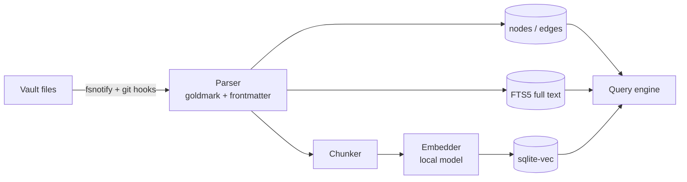
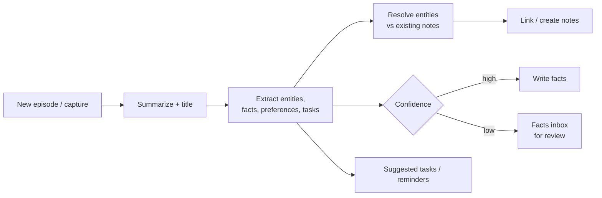

# Vault — Knowledge Base and Memory

> Status: draft v0.1

The vault is Nexus's long-term memory. It is a **folder of Markdown files in a git repo**, fully
compatible with Obsidian. Nexus indexes it into a graph with full-text and semantic search, and every
agent can read and write it through the same tools.

## 1. Principles

- **Files are the truth.** The SQLite index is a cache; delete it and it rebuilds.
- **Obsidian-compatible.** YAML frontmatter, `[[wikilinks]]`, `[[note#heading]]`, `![[embeds]]`,
  `#tags`, `_attachments/`. Open the vault in Obsidian at any time.
- **Agents are first-class authors.** Every agent write is a git commit with the run id, so you can
  see and revert what any agent changed.
- **Raw first, refined later.** Captures land immediately as raw notes; enrichment is async.
- **You stay in control of facts.** Uncertain facts go to a review queue instead of silently
  becoming "truth".

## 2. Folder layout

```
vault/
├── inbox/            # raw captures waiting for processing
├── daily/            # daily notes (brief, log of what happened)
├── episodes/         # what happened: task runs, meetings, orders, conversations
├── people/           # entity notes
├── projects/
├── places/
├── products/
├── topics/           # concepts, research
├── resources/        # articles, PDFs, links (summaries + source)
├── finance/
├── agents/           # agent definitions (see AGENTS.md)
├── workflows/        # workflow definitions (see WORKFLOWS.md)
├── policies/         # trust levels, budgets, model aliases
├── templates/        # note templates
└── _attachments/     # images, PDFs, audio, screenshots
```

Folders are conventions, not rules — the `type` in frontmatter is what matters.

## 3. Note types (frontmatter)

Common fields on every note:

```yaml
id: 01JABCD...          # ULID, stable even if the file is renamed
type: person            # person | project | place | product | topic | resource | episode | daily | agent | workflow | policy | fact
title: João Silva
aliases: [João]
tags: [work]
created: 2026-10-11T21:00:00Z
updated: 2026-10-11T21:00:00Z
source: ios-share | agent:grocery-continente | obsidian | email | ...
```

| Type | Extra fields |
|---|---|
| `person` | `email`, `phone`, `company: "[[ACME]]"`, `relationship`, `birthday` |
| `project` | `status`, `repo`, `machines: ["[[mac-studio]]"]`, `agents` |
| `product` | `store`, `brand`, `size`, `usual_qty`, `price_history` |
| `episode` | `when`, `task_id`, `agent`, `participants`, `outcome`, `cost` |
| `resource` | `url`, `author`, `summary`, `read: true/false` |
| `fact` | `subject`, `predicate`, `object`, `valid_from`, `valid_to`, `confidence`, `status: proposed/confirmed/rejected` |

### Typed relations

Plain `[[links]]` become untyped `links_to` edges. Typed relations come from frontmatter keys whose
values are links, or from inline fields:

```markdown
---
type: person
works_at: "[[ACME]]"
knows: ["[[Maria]]"]
---
Prefers:: [[Delta coffee]]
```

## 4. Index and graph



- **nodes:** one per note (+ per heading block for long notes), with type and properties.
- **edges:** `(src, dst, type, valid_from, valid_to, source)`.
- **FTS5:** title, aliases, body, tags.
- **vectors:** chunk embeddings from a local embedding model.
- Index updates are incremental (file hash per note).

### Retrieval (`memory.search`)

1. Full-text + vector search in parallel → candidates.
2. **Graph expansion:** pull 1–2 hops of neighbours of the top candidates (people, projects,
   products linked to them).
3. Rerank (local model or reciprocal-rank fusion) with recency and type boosts.
4. Return snippets with note links so every answer cites its sources.

## 5. Memory pipeline

Runs async on a cheap local model; heavy work can be escalated.



- **Episodic memory:** `episodes/` — what happened, linked to everything involved.
- **Semantic memory:** entity notes + `fact` notes/fields — what is true (with time validity).
- **Preferences:** facts about you ("prefers lactose-free milk"), editable on the phone.
- **Procedural memory:** agent playbooks and "Lessons learned" sections.

When a fact changes ("moved to Lisbon"), the old one gets `valid_to` instead of being deleted, so
"where did I live in 2025?" still works.

## 6. Sync

- The Hub owns the canonical git repo and auto-commits (batched) agent and app writes.
- Desktop machines can run `nexus-node --vault-sync` to keep a local clone for Obsidian; edits are
  committed and pushed automatically; the Hub reindexes on pull.
- Conflicts: line-level merge; if it fails, both versions are kept and a review card is created.
- iOS keeps an offline cache (recent + pinned notes) and queues writes.
- Optional: client-side encryption for a private remote.

## 7. MCP surface

The Hub's MCP server exposes the vault to any MCP client (Claude Code, Codex, Claude Desktop,
Anthrex if it speaks MCP):

| Tool | Args |
|---|---|
| `memory_search` | `query`, `types?`, `limit?`, `since?` |
| `vault_read` | `path` or `id` |
| `vault_write` | `path`, `content` or `patch`, `message` |
| `vault_link` | `from`, `to`, `relation?` |
| `graph_neighbors` | `id`, `depth?`, `relation?` |
| `facts_propose` | `subject`, `predicate`, `object`, `confidence` |
| `daily_append` | `text` |
